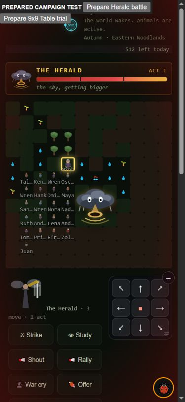

# Coalition presentation repair

2026-10-15, following `campaign-usage-audit.md`. This closes the confirmed
phone defect that hid a coalition while its actual combat turns still ran.

## Change and proof

The renderer now uses the active battle's actual grid size. It no longer
clamps a twelve-row battlefield to the nine-row world detail. Existing dirt
fallbacks cover outer arena cells. The wide-board visual class uses battle
dimensions too, so Network pieces do not depend on being classified as a
named titan to get the correct geometry.

Living allied and villager fighters render at their **combat positions**,
with actual local/foreign roster portraits where available. Dead and fled
fighters disappear; stale world monster/animal/Haven positions do not fill
their places during combat. Recruited volunteers have already been named
aloud; unintroduced local helpers retain the existing name-knowledge gate.
Full names are escaped and exposed as accessible image labels/titles.

The first phone pass exposed another presentation problem: the inherited
`.39em` labels became 3.95px on the crowded board. Wide battle labels now
measure 12px. Names truncate within their cells, with full accessible names;
the smaller portraits leave room for those labels. CSS was explicitly
cache-busted in the development fixture to verify the current stylesheet.
No release version or service worker was bumped.

The new shared-harness proof creates a real recruited army and executes the
actual `combatPresentation` and `renderDetail` functions from `app.js`.
Only DOM/art/targeting helpers are substituted for the Node renderer test;
combat, recruitment, rosters and geometry use the real loaded game. It
checks ordinary/interior/finished battles, all living allies, outer cells,
dead/fled actors, nine-cell compatibility, name gating and markup escaping.
Nineteen assertions pass. Replacing only the renderer under test with the
frozen `7ed2cf52` renderer gives thirteen passes/six failures. This is a
renderer negative control, not a claim that the new presentation helper
existed in the baseline.

## Actual phone playtest

Used the computer-use skill and a fresh localhost origin at **390x844**.
The visible, explicitly prepared fixture supplies strong relations, real
gear/food and nearby arena placement. Recruitment/outfitting/start are real
public actions. This does not establish natural acquisition or campaign odds.

| Live UI case | Rows | Cells | Visible allies | Outer allies |
|---|---:|---:|---:|---:|
| First Herald fixture | 12 | 144 | 20 | 4 |
| Final readable-label Herald fixture | 12 | 144 | 21 | 5 |
| Ordinary bulldozer fight | 9 | 81 | 0 | 0 |
| Direct Table Finale trial | 12 | 144 | 0 | 0 |

After resolving the ordinary starter choice, tapping **Wait** in the first
Herald fixture advances real combat. Thirteen of twenty displayed allies
change cells by the next player turn. Raw DOM positions are saved in
`coalition-ui-movement.json`. The final fixture shows 12px labels, full
accessible names and no horizontal page overflow. The ordinary fight keeps
its nine-cell layout. No console warnings/errors were observed.

### Corrected assumption about the Table trial

The old renderer comment said the direct Table trial was 9x9. The live
trial and code contradict that: core `startCombat` gives `finale` a 12x12
arena because it is a titan. The renderer correctly follows that actual
size. The focused nine-cell titan case is an **explicitly prepared geometry
compatibility check**, not evidence that the current live Table trial uses
nine cells. Ordinary combat is the live nine-cell comparison.

This probe also shows the direct trial receiving the Finale heart's
campaign narration and a Bad Note action. The outer Finale wrapper calls
`finaleHeartSetup` after the inner titan wrapper consumes `_tableTrialDirect`.
That deserves a separate audit: Table challenges should not accidentally
inherit world-campaign rewards or resolution. This presentation repair does
not change that runtime behavior or declare it correct.

## Validation and remaining work

- **19 focused assertions pass**; frozen renderer control fails six.
- **114 quick scripts pass**, 0 fail, 29 seconds.
- **886 full scripts pass**, 0 fail, 155 seconds after the final runtime/CSS edits.
- After the full run, only proof-test assertion labels were clarified; the
  nineteen-assertion proof was rerun successfully. Its behavior is unchanged.
- Wiring scanner: 504 app functions, ten pre-existing uncalled functions;
  the new helper has both real renderer callers and is not flagged.
- Syntax and `git diff --check` pass. No release, push or deployment.

This is a presentation repair. Node natural sims exclude `app.js`/CSS, so
repeating a natural balance matrix would not measure it. The previous raw
campaign screens remain the survival evidence. The next gameplay work is
still Finale bearer survival, cautious overtime/food entry, later campaign
nodes and actual Network coverage. Preserve the broader roadmap and the
open noncombat crafting/livelihood/item-promise audits.
