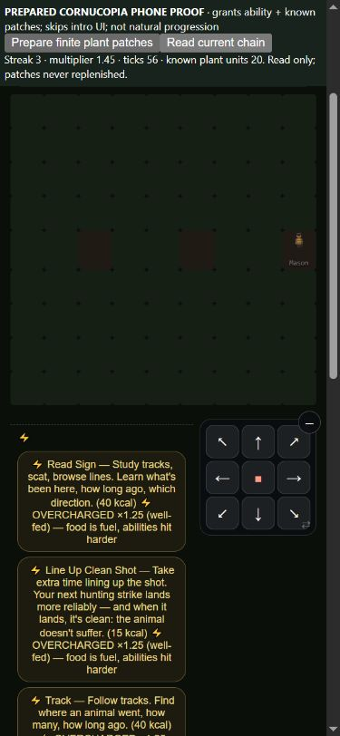

# Cornucopia: actual forage callers and a playable chain

2026-10-15–16. Baseline bc4abde11bc1d1c8d2ec0c970de6c67eed60abb1.
Retain the final caller repair, with needs-eyes review of walking between
patches. No win target, compensating buff, release or master merge.

## Missing payoff and final behavior

The old buildarounds.onForage/forageMult functions had no game callers.
Real player harvesting and NPC foraging never received this promised payoff.
The repair uses the existing15percent increment, ten-stack cap (+150percent),
advancing before the current yield. Player plant units follow the existing
ceil rounding; abstract NPC duty/trip kcal follow existing integer rounding.
The NPC adjacent-food model scales its25 hunger relief and random surplus.
Actual resident holders use their own canonical identity and ability, not
the player's assembly. The getter creates no state. Unknown plants remain
unknown, with the same actual plant/source records as the ordinary harvest.

village.cornucopia[personId] saves {streak,sequence}. Sequence advances on
every gather, including at cap, so nested public actions can distinguish an
actual gather from unrelated work. Legacy unscoped player state is readable
until the next action, but cannot become a successor's chain. Real save/load,
death/mantle, actor separation and tactical party participation are tested.
No new telemetry events or diagnostic game-helper calls are introduced.

Walking between finite patches keeps focus. Failed gathering, full-pack
refusal, wood/ruin-only gathering, other paid work, combat and dawn break it.
The native cellInteract wrapper still adds its usual tick, now belonging to
the gather it delegated. Both pathStep and microMove still charge their real
clock and world activity. The wording on the ability card matches this rule.
Treating travel between patches as part of devoted gathering is an Agent
design judgment for Steve's review: the previous card said anything else
breaks the chain, but a successful area sweep consumes the adjacent plants.

The NPC duty/trip models remain abstract, including existing positive scraps
on stripped ground. Adjacent NPC private food and surplus provenance are not
a complete physical-intake model; no universal provenance/parity claim is
made. New species lookup for an adjacent Cornucopia holder can resolve lazy
species using real RNG. That and changed hunger/food can change subsequent
choices, ecology and random histories. No rates, XP, prices, metabolism,
slots, offer order, Table gates, region or nomad files changed. The existing
player carry precheck still estimates prebonus yield, as it does for other
yield bonuses; this unit does not claim a general capacity repair.

## Rejected first implementation and native phone proof

The first candidate reset on walking and omitted the public cellInteract's
extra tick. It passed30 runtime checks, quick169/169 and full941/941.
Actual native Forage immediately displayed streak0/multiplier1.00 at17ticks.
That functional failure, and the inability to walk between depleted patches,
caused rejection. Its exact source,30-check proof,80-row screen, phone image
and DOM are retained under the initial arm. An earlier prepared map used an
unsupported synthetic forest type and failed arrival; changing the fixture
to the real grove type corrected that fixture defect before this proof.

The final33-check proof includes the real public wrapper and two finite
patches with actual walking, yielding7+8 known units under controlled RNG.
Baseline passes17 and fails16 of those same33 assertions; final passes33.
Baseline failures include new canonical-state predicates and are not all
independent numeric failures. Reconstructed final sources also pass33/33.

The390x844 browser flow is explicitly prepared: one Cornucopia ability,
4000kcal, no XP grants, known L2 dandelion, a grove with three finite patches,
and early prompts suppressed. It is not natural ability acquisition or a
human campaign. A read-only fixture viewer displays saved raw streak, actual
multiplier, clock and physical plant units above the ordinary game.
Save=true -> reload -> Continue -> native Forage -> real native D-pad walking
-> native Forage across the other patches reaches streak3/multiplier1.45
at56ticks. Native Pack contains20 physical units in3 stacks (3+6+11).
A real Franz quest took3 gathered dandelions for500pantry kcal during the
flow:20 is net inventory, not gross harvest or a claimed standalone bonus.
Native Wait advances to128ticks and breaks the chain to0/1.00, keeping20units.
Owned tabs/servers were closed and the viewport capability reset afterward.



## Matched campaigns and the decision

Same current collector/contract, policy/harness revisions,150 loop days,
Columbus origin and default flags against all frozen roots. Five policies:
capable, maker, merchant, caregiver and the declared garden-feeder. They
are mixed playstyles, not certified pacifists. Capable's unanswered intro
knack remains an explicit policy limitation; see knack-policy-audit.md.

Initial16 screen:80 baseline +80 initial rows. Final16 screen: the same80
baseline rows +80 final rows. Final64 comparison:320 baseline +320 final
rows, containing the final screen. There are720 unique campaign rows across
the three roots, not880 independent rows.735 distinct verified case-cache
jobs include15 off controls; each root has five on/off pairs at seed7.
Cached jobs were reused only with exact identity/source/observer/contract
and result-digest validation, never re-keyed. Unused Miser cache entries
are excluded. All sources remain stable, all controls match, zero warnings
or observer/gear errors. All207 fingerprinted source files are verified.

| Policy (64 seeds) | Wins | Player deaths | Community losses | First bearer through60 | Named-class cases |
|---|---:|---:|---:|---:|---:|
|capable|55 ->55|90 ->92|8 ->8|34 ->34|45 ->46|
|maker|21 ->18|52 ->57|18 ->19|53 ->53|53 ->54|
|merchant|25 ->25|42 ->44|14 ->14|57 ->57|46 ->46|
|caregiver|23 ->24|45 ->49|18 ->16|53 ->54|49 ->50|
|garden-feeder|36 ->37|47 ->48|8 ->8|54 ->54|48 ->48|

cornucopia-confirmation.md retains all23 metrics per policy and exploratory
paired intervals. Decision remains review_required: maker invitations and
entries22 ->19 also warrant review, along with its death/community outcomes.
The16-screen's maker NPC-class warning weakens in64. Other hydration,
reserve, low-HP, hunger, living-NPC, national scale and useful-intake signals
are retained rather than canceled by any win gains. No independent holdout
was run; confirmation-sized here describes sample size, not a causal claim
or statistical discovery. No small effect is declared established.

Retain because the promised actual payoff is now called and spatially usable,
with runtime and public controls proven. Do not add food or ease Table gates
to recover three maker wins. Investigate named tail transitions and actual
opportunity before further tuning. The observed changes do not establish
that this missing payoff was the cause of every later death or ending.

## Representative tails and feature coverage

Four before/after rich replay pairs reproduce their standard campaign rows
and full canonical gameplay hashes. Each has an off-observer control:16
diagnostic jobs, eight neutral pairs, no warnings or truncated events. These
are selected diagnostics, not a census of all changed campaigns.

* maker7: natural NPC Hannah Kim first receives1.15x at an adjacent gather
  on82. First selected daily resource difference is pantry112769 ->112594,
  with player kcal2360 in both. The species lookup and subsequent food/needs
  history are coupled; the bonus does not imply higher net daily stock.
  The day69 player combat death precedes this effect in both arms. Baseline
  has another combat death114 then wins115; final has one total death but
  loses the community129. Fewer deaths is not a complete success verdict.
* capable777: natural NPC gen_q446jzc receives1.15x on a real returning forage
  trip73. First selected daily resource difference is pantry3324 ->3400;
  player kcal2223 in both. Baseline wins90 without player death; final has
  combat death80 and community loss83. Later combat causality is unresolved.
* caregiver8: the player first gets1.15x on46; pantry142271 ->142811 that
  selected daily sample. Baseline combat death115/community loss119 becomes
  no player death and win96. The replay only reaches1.15x, not the ceiling.
* garden-feeder41: player payout begins22, pantry54510 ->54575 in the first
  selected differing daily sample; sampled multiplier later reaches1.30x.
  Starvation9 is identical and predates the effect. Baseline later combat
  death107 (two total) becomes combat deaths76,93,140 (four total), with
  community loss140. First-bearer day60 failure is unchanged.

These resource samples are nominal pantry item sums, not free capacity or
exact continuous consumption. The diagnostic records selected raw fields
after policy.daily, not every intermediate state. The first full-state
hash difference can include the changed ability description/offer text and
must not be called the first numeric gameplay difference.

The retained census aggregates calls/effects, grant source/tier/actor,
recipe knowledge/readiness and class/god coverage from every raw row.
Earned player T3+ gear remains319/320; contest/show cases316 ->315;
craft/trade T3+ stays0. Thirteen player subclasses appear in each arm, with
no new breadth claim. Show settlements1955 ->1944 and contest settlements
4153 ->4156 include all observed actors, not unique player rewards.
Sixteen observed methods have zero calls across all five policies in both
arms (including renderFat, makePemmican, expandStorage, institutional
trade/covenants and Network calls). Opportunity/knowledge/authority and bot
coverage need separate audits; zero use does not prove broken runtime.
These campaigns establish neither peaceful human viability nor reward
sufficiency for every playstyle. Garden's authored deed, eight fitting god
deeds, wider passives/scale parity and natural titan/Network/Finale remain open.

## Checks and reproduction

Final quick169/169 and full941/941. Ontology111 systems passes;
buildarounds static wiring26 functions, zero unwired. Those are module-level
checks, not proof of universal gameplay completeness. No core measurement
collector/contract changed, so this does not replace balance-proof.json.

Exact Git base plus arm replacements and proof versions are in the source
bundle. Existing-output refusal and all207 source hashes are checked:

```text
node evidence/2026-10-15/cornucopia-reconstruct.cjs before <fresh-before>
node evidence/2026-10-15/cornucopia-reconstruct.cjs initial <fresh-rejected>
node evidence/2026-10-15/cornucopia-reconstruct.cjs after <fresh-after>
node <fresh-after>/scripts/godpath/test-cornucopia-wired.js
node scripts/balance-panel.js --root <root> --policies capable,maker,merchant,caregiver,garden-feeder --n 64 --par 6 --out <panel>
node scripts/balance-panel.js compare --before <before-panel.json.gz> --after <after-panel.json.gz> --out <report>
node evidence/2026-10-15/cornucopia-replay.cjs <root>  maker 7 on <replay.json>
node evidence/2026-10-15/cornucopia-verify.cjs
```

Use off for each diagnostic control. The three reconstructed roots each
reproduce maker7 on/off and the retained row/full hash (six fresh jobs).
The initial arm intentionally has the old30-check proof; before/final share
the same final33-check proof. This prevents retrospectively treating the
native fix as tested by the initial proof. All source roots have null Git
HEAD metadata; none inherit the outer checkout's moving HEAD. The fixture
generator is retained for a fresh-origin native browser replay. Muse can
use the pushed branch and the common measurement workflow without importing
any alternate regional tree. The separate shared measurement draft's known
red suite is unchanged by these primary-branch results.
