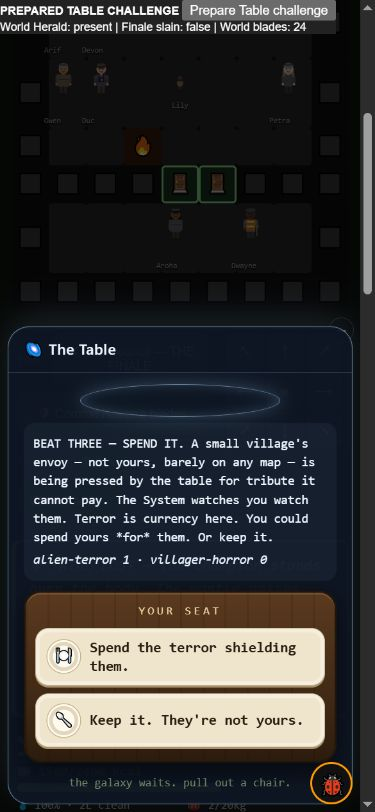

# One bearer, one body: committed-volunteer mantle transfer

2026-10-15. Follow-up to the actual Table trial loss in
`table-trial-isolation-audit.md`, where the successor was already listed
among Haven's committed blades.

## Confirmed defect and repair

A real `playerDeath` transfer to a committed volunteer left that person in
the muster and in `village.titanCommitted`. They could supply the army's
tenth blade, consume its 1,000-kcal upkeep, and spawn as an allied fighter
while also being the player. The world renderer could also draw them at
their stale NPC position. Eight initial checks fail against the original
runtime; ten fail when the separate Network survivor caller is included.

The living Haven-blade reader now excludes the current bearer. The actual
`mantleBecome` call reconciles muster entries and clears the new bearer's
committed-workforce flag. It changes no foreign recruits or donated gear.
Dawn applies the same reconciliation to old saves. Pure readiness reads
exclude the bearer even before that cleanup, and Network survivor floors
use the same reader rather than counting raw Haven entries separately.
The world renderer excludes the current bearer from its NPC-position pass.

The vacated place is not automatically filled. Another real villager must
volunteer through the existing two-tap action. Gate sizes, per-blade food,
damage, armor and recruitment quotas are unchanged. The bearer still pays
their normal personal food costs; the army no longer charges for their
nonexistent second body.

## Shared-runtime proof

The seeded fixture recruits actual foreign faces, transfers real spare
knives through `titanOutfit`, and commits three Haven volunteers. For the
gate probe, seven foreign people plus those three volunteers meet the
unchanged ten-blade Herald requirement. Trust prepares who will inherit;
`playerDeath` performs the real selection/transfer, rather than assigning a
new player ID directly.

After transfer there are nine allied bodies. The gate refuses nine; army
upkeep consumes 9,000 from 20,000 prepared carried calories; actual allied
injection into a test fight produces nine allied fighters and no bearer
clone. The injection fixture does **not** claim that nine allies can enter
the gated Herald battle. Another real two-tap commitment restores ten.

The old-save probes include a legacy current-bearer string entry and a
prepared started Network march. Four distinct survivors plus a duplicate
bearer cannot meet its five-survivor floor. Adding a fifth actual survivor
permits the real current-node entry and produces five allies without a
clone. The Network is explicitly summoned/prepared for this boundary test;
this is not natural reach or a completed campaign.

**14 assertions pass; the frozen `9d981acc` runtime has four passes and ten
failures.** The actual UI renderer proof also passes 21 checks, including
one player token and no stale NPC rendering of that same bearer. The frozen
renderer gives twenty passes and one failure on that duplicate NPC case.
The 43-check Table/world-campaign isolation proof remains green.

## Natural screen

Same 16 seeds, 240-day horizon, standard driver and `capable`/`campaigner`,
one game per child process. Baseline runtime is frozen at `9d981acc`.
The final after screen was rerun after adding the Network reader, rather
than mixing the earlier partial repair's source hash with the final code.

| Policy | Table wins before | Table wins after | Herald kills before/after |
|---|---:|---:|---:|
| capable | 13/16 | 13/16 | 0 / 0 |
| campaigner | 10/16 | 11/16 | 6 / 6 |

Thirty-one of 32 paired final gameplay hashes are identical. The changed
trajectory is **campaigner seed 9**: it still has a sickness mantle transfer,
but runs to a Table win on day 103 rather than ending without a win on day
94. Provisioning, attrition and later choices consequently diverge. This
is an observation of the identity repair bundle, not proof of a reliable
win-rate improvement or the isolated effect of each cleanup step. No
numeric balance lever was tuned. A small probability claim would require
the larger matched sample prescribed in `docs/SIMULATING.md`.

No run gains a Finale/Network campaign completion from this patch. The
existing food, travel and late-game coverage gaps remain.

## Actual phone playtest

Computer-use skill, fresh localhost origin, 390x844. The explicit prepared
Table/world-army fixture puts the desired committed volunteer highest in
trust, without assigning the successor directly. It otherwise uses the
same offered Table challenge, real gear, food and public recruitment.

Seven ordinary **Wait** turns let the champion kill **Debbie**. The actual
mantle selected **Lily**, who had been one of Haven's three committed blades.
The world muster dropped from **25 to 24 allied entries**; Lily now occupies
the player role. The other people remain. The Table resumed at beat three,
the separate world Herald remained, and Finale was not marked slain.

DOM proof shows **one** player token, player name Lily, and ten remaining
NPC token names with no duplicate Lily. No warnings/errors were observed.
Raw observations are in `mantle-coalition-phone.json`. As before, a passive
prepared death is not a trial difficulty or natural acquisition estimate.

## Validation and next work

- 14 mantle/coalition checks, 21 UI checks and 43 trial-isolation checks pass.
- **116 quick scripts pass**, zero failures (39 seconds).
- **888 full scripts pass**, zero failures (142 seconds), after the final
  Network guard. Ontology: 111 systems, zero errors.
- Wiring: titans 41 functions / zero unwired; Network 16 / zero unwired.
- Syntax and `git diff --check` pass. No release, push or deployment.

Next return to campaign bearer protection and tactical choices, food/travel
preparation and cautious overtime entry. Initial recruitment, UI visibility
and identity correctness do not establish a complete Finale or Network
playthrough. Keep the broad roadmap and open crafting/knowledge, livelihood
ending, item-promise and content work intact.
