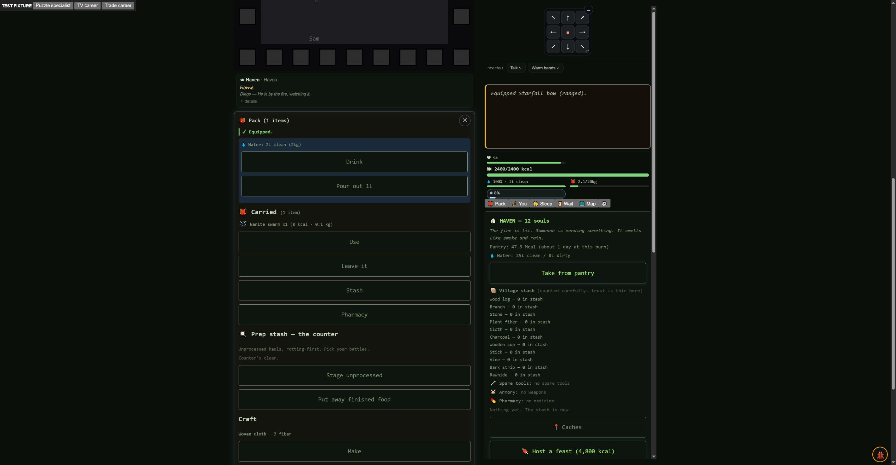
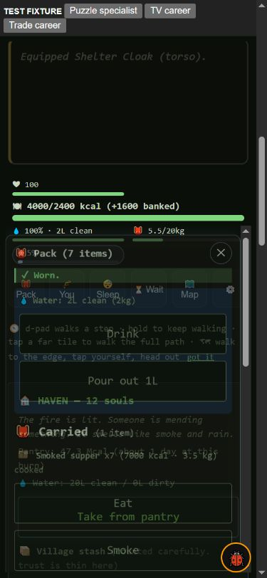

# Noncombat gear and feature-use audit — 2026-10-15

Steve: “Make sure that combat isn’t the only viable way to obtain good gear. We want to see viability in game for all playstyles. Do contests and tv shows reward enough? Auditing for any dead spots in feature usage?”

## Result and limits

Contests already awarded good weapons. The gaps were advanced armor access,
TV gifts stuck at starter quality, rewards that differed for villager winners,
and a Pack UI snapshot that erased the IDs needed to use the rewards at all.
Those defects are fixed on the local branch. **Every playstyle is not yet
proven balanced.** The active roadmap goal continues with the gaps below.

## What changed

- `Game.status().inventory` preserves item metadata in copied entries. The
  actual Pack renderer can offer Equip, Wear, Use, read/preparation and stash
  actions, and show real weight. The old four-field food summary stripped
  `itemId`, `kg`, processing state and discovery flags. Bots using the live
  scholar inventory had hidden this browser-only failure.
- Personal contest mastery (3/6 wins) or audience favor (40/70) opens higher
  reward tiers independently of monster waves. Ordinary rewards stop at tier
  3; extreme-risk expert contests retain a rare apex roll (8 wins or 100
  favor, or the existing wave-4 route). Cooking, foraging, puzzle and social
  categories use the same reward mechanism as blood contests.
- Curated prize pools include existing armor and weapons with real mechanic
  fields, including beam-resistant armor at the apex. This does not claim
  that every advertised special power on a path item works.
- Villager contest winners receive their own gear roll as well as their
  existing pantry share. Successful player/villager TV appearances have a
  35% gift opportunity; authored prizes remain, and ratings summons keep a
  single care-package reward. Re-entry cannot duplicate prizes.
- Hot fan gifts favor their earned tier (55% at tier 2, 70% at tier 3) while
  keeping a small starter fuel/medicine lane. The exclusive-high-tier screen
  starved the reactor-seed supply; retaining that lane avoids silently
  retiring another feature. No food gifts or extra package cadence were
  added. Fusion-reactor singularity and effect discovery are preserved.
- Three/eight completed trades open tier-2/3 cart stock, priced with real
  finished food. Selling counts as completed trade too. Routine carts do not
  sell apex gear. The generator's wildcard also respects the same kin age
  gate as its dedicated keepsake slots (a genuine flaky-test discovery).

All levers are in `src/data/reward-economy.json`; the new shared-harness
proof validates the data as well as the runtime contracts.

## Comparable evidence

The final primary matrices use **the same standard `sweep-compare` driver**,
seeds, 150-day horizon and policy bytes on frozen source trees. The census
observes acquisitions; it neither grants gear nor changes a game decision.
Its 100-day observer-on/off regression compares every gameplay-state field
and deaths, excluding only real-time `pacing.lastTs`. Reports include source
hashes. `sourceHead` is the parent checkout revision at capture; modified
snapshot contents are identified by file hashes, not claimed to be clean
HEAD. Starting gear, worn-item transfers and succession are excluded from
prize counts. Corpse kinds remain separate: dead villagers' possessions are
not monster-loot rewards.

An earlier custom day-sampling cadence produced different trajectories;
those exploratory outputs are retained locally under `.git/gear-exploratory`
and are **not used for the final comparisons**. The legacy dashboard is a
separate instrument and is not numerically interchangeable with this census.

### Capable policy, 64 matching seeds

| Measure | Before | After |
|---|---:|---:|
| Wins | 43/64 | 39/64 |
| Took a seat | 56/64 | 59/64 |
| Invited | 58/64 | 62/64 |
| Runs personally earning tier-3+ gear from contest/show/package/trade/craft | 47/64 | 63/64 |
| Bearer deaths | 90 | 92 |
| Field villagers killed by monsters (specific telemetry kind/cause) | 327 | 387 |

| Source | Weapon/armor pieces | All tier-3+ items | Beam-resistant armor |
|---|---:|---:|---:|
| contest | 158 → 485 | 201 → 477 | 0 → 43 |
| show | 0 → 26 | 0 → 26 | 0 → 0 |
| fan-package | 11 → 276 | 0 → 308 | 0 → 0 |
| trade | 0 → 0 | 0 → 0 | 0 → 0 |
| craft | 49 → 44 | 0 → 0 | 0 → 0 |
| corpse-monster | 6 → 5 | 6 → 4 | 0 → 0 |
| corpse-villager | 800 → 871 | 188 → 235 | 17 → 23 |
| corpse-person | 101 → 138 | 32 → 46 | 4 → 10 |

These are acquisitions across recipients, not unique items or successful uses.
The middle column includes consumables/tools as well as gear. Improved access
is clear; survival and win-rate improvement are **not established**. Villager
attrition remains a watch item. A bundled change plus changed RNG trajectories
cannot identify each lever's causal contribution, and flexible win targets
are not quotas to force by tuning.

### Livelihood policies, 16 matching seeds each

Same capable survival/choice brain; deliberate hunts and feast patrols off.
Feasts/devotion remain on. Ordinary defence and unavoidable fights remain.
These are **not pacifist proofs**. The old `socialite` bot's inability to take
a seat is a bot limitation and is not a verdict on social play.

| Policy | Wins /16 before → after | Seats /16 | Personally earned good gear /16 | After buys / sales | Policy/observer errors |
|---|---:|---:|---:|---:|---:|
| merchant | 3 → 7 | 4 → 8 | 15 → 16 | 5 / 31 | 0 |
| maker | 4 → 7 | 5 → 9 | 15 → 16 | 5 / 25 | 0 |
| caregiver | 2 → 3 | 3 → 6 | 15 → 16 | 0 / 0 | 0 |

Merchants now keep/earn an actual food budget, rather than donating every
sale before reaching a cart. Bought stock in these organic runs is mostly
useful starter tools/medicine; advanced trade stock is proven end-to-end in
a prepared career, not yet common enough organically to call the merchant
gear ladder complete. The maker probes also still expose scarce recipe and
material use. Sixteen seeds show reachability and suggest follow-up levers;
they do not settle small balance differences or cover every job/subclass.

## Real browser playtests

The loopback-only fixture prepared career milestones and food; it did not
force the prize roll or replace the production choice/equip handlers.

- Played The Box: participate, study, trust the chat, elegant solution.
  A real reward appeared in the Pack. Before the fix there was no Equip
  button; after it, the Starfall Bow equipped into the ranged slot.
- At 390×844, opened the real trader, paid three smoked-supper units for a
  Shelter Cloak priced at 3,700 kcal (preserved-food credit is real), then
  pressed Wear. The UI confirmed `Equipped Shelter Cloak (torso)`.
- Played WHY DO THEY EAT? through the comfort-dish choice. This appearance
  did not roll a gift, as allowed by the 35% chance. No false guaranteed-TV
  claim is made. Browser warnings/errors were empty. Mobile Pack layering
  is crowded and remains a presentation follow-up.

## Feature dead spots and the next work

The 32-run coverage audit (capable + legacy socialite, 16 seeds each) exercised
3,523/5,121 named functions (69%), with zero crashes. Debug/audio-only functions
are in that denominator, so the remainder is not a dead-content percentage.
Four swallowed-error sites were reported, including headless localStorage and
null-coordinate reads during initialization. They are disclosed in the raw
coverage report, not counted as successful behavior.

| Area | Evidence / diagnosis | Next proof |
|---|---|---|
| Pack item actions | Real browser failure; fixed | Keep reward→Pack→use coverage alongside bots |
| Contests | Existing good weapons, no armor in alien-only pool; repaired | Per-category risk/cost/usefulness, not just item counts |
| TV / fans | Almost no gear before; improved earned quality | Organic actor/club growth and unique useful prizes |
| Crafting | Existing armor/weapon recipes remain basic; no tier-3 ladder | Recipe learning + materials + coherent earned upgrades |
| Trade | Old bots never traded; livelihood probes now do, few advanced buys | A viable food-production/sales/career budget over whole runs |
| Preservation/pemmican | Sparse or absent in ordinary policies; specialist conditions needed | Real learned technique, cooked meat, fire, spoilage pressure |
| Storage/armory/stash | Ordinary sweeps rarely or never use public transfer/expansion verbs | Load/shortage-driven probes and real mobile controls |
| Direct care / party orders | Care comfort is now exercised; many other verbs still absent | Visible-need care, role/formation/orders under pressure |
| Peer leagues | Trade/covenant verbs unused by the ordinary LEAD-road bot | Separate league policies before retuning |
| Titan / Network | Still unexercised by default seat-taking policies | The already logged campaign-seeking bot and full campaign |
| Item promises | Many `baseEffect` descriptions and `tradeValue` fields have no runtime readers | Implement/correct advertised effects; `findable` alone is not access |
| Class/job spread | This matrix does not prove all jobs/subclasses | Matched occupation/build probes, including rare noncombat classes |

An unused verb is a **coverage gap** until a targeted probe distinguishes an
unreachable gate, a weak payoff, an unfinished implementation, or a missing
bot choice. The priority list is carried into `docs/ROADMAP.md`.

## Validation and recovery

- Full green list: **880 scripts passed, 0 failed** (`.git/full-gear-tuned.log`).
- Latest quick suite: **108 passed, 0 failed** (`.git/quick-gear-delivery.log`).
- Noncombat rewards/data/Pack proof: **36 assertions**.
- Census proof: **8 assertions**, including 100-day observer state equality.
- Ontology: **111 systems validated**. New helpers have real terminal callers
  and runtime proofs; the old whole-game wiring warnings are not an all-clear.
- Existing fixture repairs pin unknown plants, the one pending lesson, real
  rotten food, bare/unskilled flee cases, held-dialogue navigation and opposed
  live-lie reactions. The old partial social loader now uses the full shared
  kit. No assertions were weakened and no tests were quarantined.
- Local commits only; no deployment or release-version bump. The broad goal
  remains active. Do not call every playstyle balanced or the roadmap done.

Primary files: `gear-usage-final-before-64.{json,md}`,
`gear-usage-final-after-64.{json,md}`,
`gear-usage-livelihood-control.{json,md}` and
`gear-usage-livelihood-tuned.{json,md}`. Run commands and hashes are in
`noncombat-gear-validation.json`.
