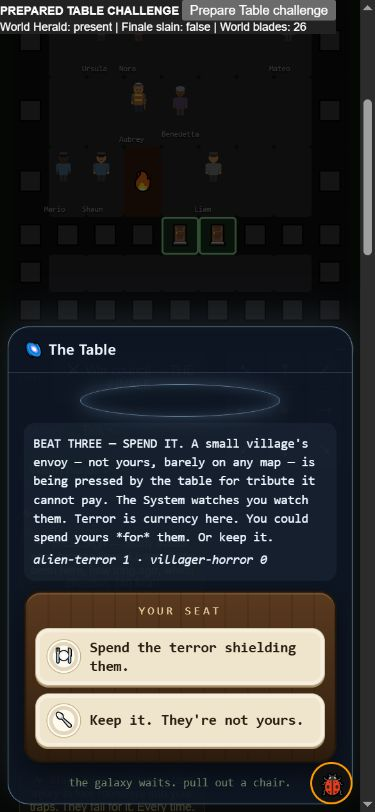

# Table trial and world campaign isolation

Follow-up: `mantle-coalition-audit.md` confirms and repairs the committed
volunteer's duplicate bearer/NPC role noted below. The earlier raw muster
count and screenshot remain historical evidence of that finding.

2026-10-15. Follow-up to the phone finding in
`coalition-presentation-audit.md`. A direct Table challenge was entering
the Finale's world-campaign setup after the inner titan wrapper consumed
the temporary `_tableTrialDirect` flag.

## Confirmed defects and repair

The outer wrapper marked the trial as `finale_heart`, gave it crew spoils
without playing the crew, and announced the world apocalypse. On resolution,
the campaign/titan wrappers could mark the world Finale slain or break its
muster. Core combat also lifted the nearest world monster off the map and
inherited its veteran/position/phase fields for the summoned champion.
At Haven, the summoned trial could also be recorded as a breach.

The offered Table choice now passes explicit `{tableTrial: true}` context.
Both party wrappers forward every argument, so the context reaches core
combat; real entry tests caught those wrappers discarding the second
argument. The temporary flag remains supported for existing callers and
is converted to the same explicit context before being cleared.

The per-fight context keeps the summoned champion separate from nearby
world monsters, avoids the artificial breach, and makes trial resolution
skip world-campaign effects. Finale setup captures the context before the
inner wrapper clears the old flag. Its crew tools are neither granted nor
usable in a trial, including leaked tools in old saved trials. A pure
`tableTrialFight` discriminator recognizes both new fights and old pending
Finale trials; the latter's leaked heart mark is retired without resolving
the world titan. Ordinary world campaigns still mark their heart, inject
their force and provide earned tools. Actual titan arena size, champion
mechanics, damage, armor and rewards outside this isolation are unchanged.

## Shared-runtime proof

`test-table-campaign-isolation-20261015.js` uses one seeded shared game.
Each fixture prepares a progressed world campaign, real recruited foreign
volunteers and a nearby veteran world monster. It offers beat two of the
Feared challenge through `tableRunBeat` and enters via the actual
`chooseTableOption('beat:trial')` action.

Forty-three checks cover real entry, one champion, no unrelated veteran
inheritance, preserved world monsters/musters/progress/foreign rosters,
unusable leaked tools, the Table's win/loss/retreat consequences, actual
mantle passing on terminal loss, once-only resume, legacy context and
ordinary world-campaign behavior. The explicit `won`/`fled`/`lost` calls
are **terminal resolution fixtures**, not simulated combat victories or
estimates of difficulty. The phone loss below uses actual combat turns.

All **43 checks pass**. Running the same proof against the frozen
`3655db8b` runtime gives **18 passes / 25 failures**.

## Natural regression screen

Same standard driver, 16 seeds, 240-day horizon, `capable` and `campaigner`:
32 games per version, one game per child process. Source is frozen during
the runs; raw rows are adjacent. Additional changed-wrapper hashes were
appended from those unchanged source roots after measurement; rows and
gameplay hashes were not modified.

| Policy | Table wins before | Table wins after | Herald kills before/after |
|---|---:|---:|---:|
| capable | 13/16 | 13/16 | 0 / 0 |
| campaigner | 10/16 | 10/16 | 6 / 6 |

**All 32 matched final gameplay hashes are identical.** No natural run in
this screen entered the direct trial, so this proves regression stability,
not natural trial reach or a balance improvement. Dedicated runtime tests
and real UI entry establish the repaired boundary. No Finale or Network
campaign completion is added by this work.

## Phone playtest

Computer-use skill, fresh localhost origin, 390x844. An explicit prepared
fixture supplies the Table beat, progressed world campaign, food/gear and
26 listed world blades. The actual **Demand the champion** choice starts
the real trial. It renders 144 cells, offers no Red Pen/Leaked Script/Bad
Note buttons, retains the nearby world Herald, and does not enter the
world-campaign heart. The ordinary starter choice was resolved normally.

Seven normal **Wait** turns were played without changing HP, monster stats
or outcomes. The champion killed **Carlos**, the mantle passed to
**Benedetta**, and the Table resumed at **BEAT THREE — SPEND IT**, with
terror reduced from four to one and real choices available. Haven had
eleven survivors. The separate world Herald remained present, Finale was
not marked slain, and the world muster data retained its 26 entries. No
browser warnings/errors were observed. This passive prepared loss is not
a measure of how an equipped, active late-game build should fare.

The new bearer was one of the previously committed Haven blades. This
raises a separate identity issue: `titanHavenBlades` currently filters only
roster membership/duplicates, without excluding the current bearer after
a mantle transfer. Audit actual injection/upkeep/readiness before calling
the raw 26-entry muster twenty-six distinct *active* allied fighters.
This finding is not resolved by the Table isolation patch.

## Validation and next work

- 43 focused assertions pass; frozen original fails 25.
- **115 quick scripts pass**, zero failures (39 seconds).
- **887 full scripts pass**, zero failures (137 seconds).
- Ontology: 111 systems, zero errors. Table-feared: nine functions, zero
  unwired; Finale campaign: 36 functions, zero unwired.
- Syntax and `git diff --check` pass. No release, push or deployment.

The first quick run caught an invalid descriptive suffix in the new
ontology declaration; it was corrected to the validator's function-only
format. No gameplay assertions were weakened.

Next: audit committed-volunteer mantle transitions, then actual Finale
bearer protection/tactical policy, natural food/overtime entry and complete
Network coverage. Broader playstyle viability, crafting/knowledge access,
livelihood endings, item promises and the full ordered roadmap remain open.
