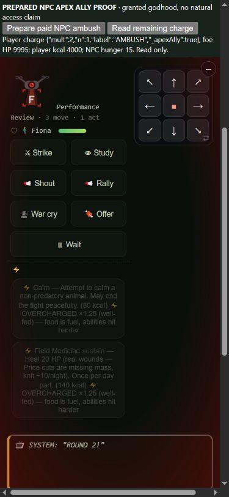

# One bearer body, then a real ally's ambush

2026-10-16. Base c78ff4f407503b35ae0a2b311cee580d79289f41.
Retain the canonical-person repair and final Apex recipient repair.
Reject the initial recipient-only candidate. No win quota or release.

## What the first candidate exposed

Apex's ally loop explicitly skipped player-kind actors. The initial repair
gave the player's real scholar strike state one existing2x ally opening,
preserved already armed commitments and cleared unused tagged charges at
fight end. It passed19 runtime assertions, quick171/171 and full943/943.
Its16-seed/four-policy screen was identical. At64, one caregiver44 row/hash
changed: fewer deaths and a different ending, with the same win/day112.

The source-bound replay showed that gen_4vi5tf5 was both Game.villagerId and
the NPC fighter v_gen_4vi5tf5. The duplicate cast as an NPC on84,93 and111.
The candidate then granted its own person an ally2x, and a subsequent own
Ambush3x stacked with it: input50 ->300 at the action-modifier boundary.
The original ends class:forager/gardener after another death111; the
candidate ends god:apex_predator with that bearer alive. Neither is valid
evidence of help from a distinct ally. The candidate is rejected, not adopted
because a death count improved. Exact source,19-check proof, panels,
screen/confirmation, direct-cast and scheduled-turn phone records are retained.

## Canonical identity repair

Succession leaves a former NPC's position and raw party/follower entries.
Normal monster and alien constructors iterated the entire roster, so that
same person could join again as a nearby NPC. Formal party membership also
reported the player as their own companion; its injection boundary's existing
ID set did not include the player, whose fighter uses key p.

partyMembers now returns unique roster companions excluding the current
canonical bearer. travelingWith excludes that same body. Raw legacy arrays
are preserved. Both nearest-four constructors exclude the bearer and
duplicate IDs before selecting companions. The formal-party boundary starts
with the bearer ID, records each inserted person and still updates initiative
when a real companion joins. Actual betrayal construction uses the corrected
membership getter. No real companion's price, health/gear values, radius,
nearest-four cap or ability is buffed.

This affects more than fights: party capacity/invitations, traveling
membership, later choices, actors and resource/random histories can change.
Removing an artificial body can help or hurt. Do not attribute every death,
ending or resource difference to one later duplicate fight. Raw NPC build/god
records can also describe the current bearer: the earlier god census is
not an eligible living-NPC denominator. That exposure/observer interpretation
needs a separate audit; the common collector is held fixed in this comparison.
NPC named-class statistics are retained with that limitation, not presented
as validated current-holder coverage.

The14-assertion shared-kit proof exercises getters, legacy-array preservation,
actual monster/alien/betrayal constructors, real initiative, duplicate roster
entries and real playerDeath into a former companion followed by combat.
Original source passes2/fails12; identity-only and final pass14/14. Those
are14 predicates, not12 separate defects. A membership-only first draft still
produced two successor bodies through the core constructor; that failing
proof identified the second entry path before freezing the measured repairs.

## Final Apex recipient behavior

A distinct living/unfled player receives the existing allyAmbushMult2,
one strike, in scholar._nextStrikes. NPC allies retain fighter._nextStrikes.
Existing commitments or personal ambushes are preserved, with no forced
player attack. Canonical self aliases receive no ally grant. When the player
chooses their own3x Apex opening, it replaces only a tagged borrowed2x
opening; it cannot stack6x. Unrelated Stoke/other commitments remain.
Unused tagged ally charges clear on actual fight end; a later replacement
without the tag is preserved. The ordinary new-fight reset remains too.

The original NPC caster3x, ally2x,120kcal data price (existing NPC rounding:
5 hunger), power rules, first-round/first-blow restriction, food gate and
one-use limit stay. No offers, XP, slots, Table gates or regional/nomad
files change. The final21-check proof passes; the same proof on original
source passes18/fails3. Actual player strikes consume the charge once and
reach target HP; the next strike has no second multiplier. The proof also
covers dead/fled/self exclusion, payment refusal, repeats, personal opening
replacement and unrelated-charge cleanup. Static godverbs wiring and real
callers are distinct evidence.

## Actual phone play

The final390x844 prepared one-body fixture trims the roster to the bearer
and two adult companions, calls real playerDeath, then starts real combat
with the successor's stale NPC position still present. Otis takes a former
companion's mantle. The viewer reports one current body and2/2 unique people;
the raw party still contains Otis but partyMembers does not report self.
The normal combat screen shows the remaining actual companion Kyle.
This is a prepared succession proof, not a natural full campaign.

The final ally fixture grants a distinct NPC Apex god and prepares round1.
It does not call the NPC ability directly. Native Wait runs the normal NPC
turn: Fiona chooses Ambush, hunger10 ->15, and Violet receives one2x charge.
The round2 read shows foe9995HP, player4000kcal. Native Strike spends the
charge, reaches9977HP and consumes the player's action; player kcal4000
and NPC hunger15 remain. Damage18 is that observed final hit, not a claim
that raw damage was9 before all other mechanics. Runtime assertions prove
the multiplier boundary separately. Browser roster generation is unseeded;
godhood/HP/day/fight preparation and a read-only viewer are explicitly marked.

The initial candidate's separate Pasquale/Penelope direct-cast flow and
Dakota/LaToya scheduled-turn flow are retained under initial/native names;
they are not final-code screenshots. A final tab first loaded at desktop
dimensions; it was reloaded at verified390x844 and the full flow repeated
before retaining final phone images. One transport timeout left the
succession preparation unexecuted; a premature fixture read then failed on
null state. Inspecting state and retrying preparation completed the proof.
A later Strike timeout had already completed the strike and was not repeated.
Owned tabs/servers were closed and temporary viewport overrides reset.
Combat controls still scroll with some background-skill sets; these images
do not certify the entire mobile layout.



## Four-arm matched measurement

Four policies (capable/maker/merchant/caregiver),64 matched seeds each,
150 loop days, Columbus origin, default flags, same policy/harness and
collector/contract revisions. Arms: original, rejected initial ally,
identity-only, final identity+corrected ally. All207 fingerprinted source
files are stable.1040 distinct verified jobs comprise1024 source/seed/policy
campaign rows plus16 off controls;16 on/off pairs include their on rows
within the campaign total. All four16-seed screens are subsets, not extra
independent campaigns. The256 policy/seed worlds across arms are correlated.
No independent holdout or small causal balance effect is claimed.

Original -> identity-only has165 equal result rows/metric sets and164 equal
full hashes. Final state can change even when the retained result/metrics
match; no broad equivalence claim is made.43 cases change a win/death/
community/class summary; the transition list retains them all. Selected
diagnostics do not claim to explain every changed history.

| Policy (64) | Wins original ->identity/final | Player deaths | Community losses | First bearer through60 | Named-class cases |
|---|---:|---:|---:|---:|---:|
|capable|55 ->56|92 ->93|8 ->7|34 ->34|46 ->48|
|maker|18 ->18|57 ->57|19 ->20|53 ->53|54 ->55|
|merchant|25 ->24|44 ->45|14 ->17|57 ->57|46 ->46|
|caregiver|24 ->23|49 ->48|16 ->16|54 ->54|50 ->48|

Both original->identity and original->final reports remain review_required.
Caregiver invitation/entry26 ->24 and class50 ->48 are review signals.
Merchant's community loss increase is retained and investigated even though
it falls below a configured materiality threshold at64. A few more wins
elsewhere cannot cancel it. The initial16 merchant loss rise5 ->8 persists
as14 ->17 at64; caregiver's16-screen win gain does not persist at64.
All23 per-policy metrics/intervals, raw rows, gear source/recipe/call census,
class/god records, food intake and ending frames are retained.

Identity-only ->final has all256 rows,23-metric sets and full gameplay hashes
equal. The corrected ally contract is runtime/native-scheduler proven, but
this panel does not establish naturally used ally-build balance. Zero
sampled change is not evidence that the contract is useless or impossible.
Initial capable-knack policy limitations and pending reactor/Garden questions
remain. These mixed policies are not certified pacifist human play.

## Representative adverse/favorable/class/gear tails

The identity observer has five before/identity case pairs, each with its
off control:20 diagnostic jobs/10 neutral pairs. The Apex observer has three
original/rejected pairs plus one final caregiver44 pair:14 jobs/7 neutral
pairs. Every retained replay matches its standard row/full gameplay hash;
all on/off pairs match, with zero warnings/dropped records. Observers only
read raw state and delegate original calls once. No new helper evaluation,
RNG or clock call is added. Daily fields are selected snapshots after policy
actions, not a complete continuous-state ledger.

* capable42: original starvation18, then first selected daily difference is
  raw party20, with HP95/kcal2184/pantry55985 equal. Original duplicate-body
  fights are observed from28; it later loses another bearer to dehydration65
  and its village74. Identity has one player death, no observed self alias
  and an Apex god ending90. Do not attribute the whole outcome to fight28.
* merchant1234: first player combat death88 is shared. Party differs89 while
  HP98/kcal2310/pantry82457 match. Original duplicates appear from125;
  identity has an extra combat death and community loss116, versus one
  player death and a living community at original147's cap. The adverse
  branch begins before that original125 fight; travel/party history matters.
* capable1: shared combat death43, then raw party differs with HP88/kcal2290/
  pantry52280 still equal. Original has another combat death72 and a
  Shepherd god ending90. Identity has one death and a field-track ending90;
  it loses named-class access despite fewer deaths and the same win.
* caregiver44: shared first death24; raw party is the first selected daily
  difference at HP95/kcal2310/pantry25300. Original's duplicate Apex caster
  appears84/93/111. Identity's next combat death is69 and its social-track
  ending100. The rejected candidate's apparently better Apex ending112 was
  clone-assisted. Final matches identity; its retained Apex replay finds no
  such NPC casts. Stored NPC-god records alone had obscured the actor identity.
* capable48: both lose their first bearer to combat71 and win a social-track
  Relay ending90 as Chloe. Original receives a T3 Death Mask from a villager
  corpse78; identity receives no earned T3+ gear. A villager wound-death75
  occurs only in original; exact mask ownership is not established by this
  observer. Original's first observed duplicate fight is80, after that grant,
  so the loot difference cannot be attributed solely to that later fight.
  Raw grants establish the lost route; no reward/stat nerf was made.

Earned T3+ weapon/armor access256 ->255; contest/show access stays252/256;
craft/trade T3+ remains0. This is not all-playstyle gear sufficiency. Recipe
knowledge/readiness and zero-call methods remain in the full census; absence
requires an opportunity audit, not a declaration of broken runtime.

## Validation, reproduction and remaining work

Final quick172/172 and full944/944 (178s) pass. The earlier rejected candidate's
171/171 and943/943 are retained separately, not substituted for final checks.
Ontology111 systems passes. Godverbs59 and encounters9 functions have zero
static unwired flags. Party has36 functions and the same pre-existing
unwired npcLeavesParty warning on original and final; it is not declared
module-wide green. The changed getters/injection are exercised by actual
constructor proofs. New identity and ally rules are recorded; static
wiring scans and actual-call proofs have separate scope. The source bundle
preserves the rejected19-check proof and final14/21 proofs, rather than
retrospectively calling the old proof sufficient. No green assertion was
weakened or quarantined. Common measurement files/balance-proof.json remain
unchanged, preserving a comparable observer across all arms.

```text
node evidence/2026-10-16/apex-identity-reconstruct.cjs original <fresh-original>
node evidence/2026-10-16/apex-identity-reconstruct.cjs rejected <fresh-rejected>
node evidence/2026-10-16/apex-identity-reconstruct.cjs identity <fresh-identity>
node evidence/2026-10-16/apex-identity-reconstruct.cjs final <fresh-final>
node <fresh-final>/scripts/godpath/test-party-bearer-identity.js
node <fresh-final>/scripts/godpath/test-apex-ally-ambush.js
node scripts/balance-panel.js --root <root> --policies capable,maker,merchant,caregiver --n 64 --par 6 --out <panel>
node evidence/2026-10-16/apex-identity-replay.cjs <root> merchant 1234 on <replay.json>
node evidence/2026-10-16/apex-ally-replay.cjs <root> caregiver 44 on <replay.json>
node evidence/2026-10-16/apex-identity-verify.cjs
```

Use off for each diagnostic control. Fresh reconstruction refuses existing
output and verifies all207 source hashes. All four reconstructed roots
reproduce maker7 on/off and standard rows/hashes (eight fresh jobs); final
reconstructed runtime proofs pass14/14 and21/21. Root HEAD metadata is null,
never inherited from the outer checkout. Retained artifact hashes use
canonical LF text and exact gzip/JPEG bytes and are checked against Git
blobs before push. Reconstruct original/final source explicitly; never copy
regional/gameplay trees merely to get tooling.

For browser reproduction, run either retained phone-fixture.cjs generator
from the repo, serve the repo on a fresh local origin and open its generated
.git/apex-ally-phone.html or .git/apex-identity-phone.html. Prepare first.
For allies use native Wait -> read -> native Strike -> read. The final ally
fixture does not directly invoke its NPC cast. These are explicit prepared
fixtures; do not replace them with hidden-state browser evaluation.
Each generator also accepts an output filename as its first argument. To
run against a reconstructed arm, run the generator from that root with
phone.html as output and serve that root on a fresh origin. It need not
create a .git directory or inherit outer-HEAD metadata. The optional-output
wrapper leaves both generated default final fixture HTML files byte-identical;
the retained output proof records their hashes.

Still open: Voice command/brawler rally player consumers; Garden recipient
food settlement and its separate seven-day interpretation; far formal
companions' legacy30HP/missing full gear; NPC exposure/coverage measurement
for records that describe the current bearer; eight fitting god deeds,
remaining contest/army promises and natural titan/Network/Finale bot coverage.
Do not infer that forty scale contexts or the roadmap are complete. No
master/main push, merge, deployment or service-worker bump is included.
