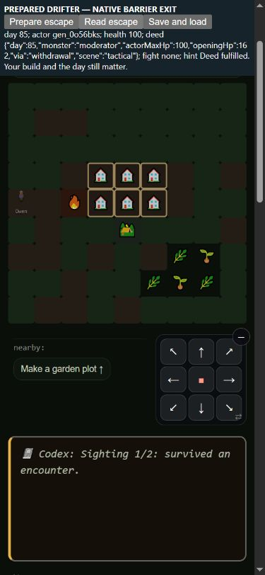

# The Between: actual individual escape

2026-10-16. Base `51186cfa0c6f94a95433177a5e6c8cc157cecae3` on
`codex/resume-claude`. Retain the authored gate for design review
(`[needs-eyes]`). Seven god deeds now replace their proxies; three remain.
Garden's diet and early reactor questions remain unanswered. Do not recover
old win rates by making survival easier or waiving another deed.

## Actual outcome and attribution

The known person must leave alive while a known fresh monster that began
with more HP than their full capacity still lives. This is an Agent-authored
fitting deed, not a quotation from Steve. HP capacity is a transparent
comparison, not a complete combat-strength score. It does not compare
current wounds, gear value or arbitrary repeated-use counts. The existing
NPC human-capacity floor100 is retained; the formal30HP proxy cannot make
the deed easier than the same person's field body.

Actual tactical individual retreat, barrier/door escape, field pre-contact
awareness evasion and wild withdrawal can qualify. A player passing through
a door does not save or credit companions left outside. An NPC who really
retreats has their own outcome even if the remaining fight continues or ends
badly. No empty evasion tap, generic fight-survived counter, kill, surrendered
foe, corpse, dead person or summoned/anonymous helper qualifies. Sealed
arenas and field judges are excluded even when their result says vFlee.

Tactical callers reuse the saved Apex opening/identity evidence, including
freshness and door-reentry wound detection. Old fights without that evidence
cannot invent history. NPC reactive, predictive and AI flight callers record
the actual fleeing body immediately; combat completion handles actual player
flight and does not lend it to other bodies. Field opening/result callers
use actual living individual evasion/withdrawal, not an assumed party escape.
The first canonical-person receipt survives saves/succession; class age and
synergy cannot bypass it. Existing active gods and the class/payoff/four-magic/
day80 gates remain. No new damage, movement, pursuit, fee, food price, kit,
policy, regional or nomad change. Telemetry shares an existing timestamp;
there is no extra random/clock draw for a receipt.

## Runtime, saves and phone

- Original23-check RED:14 passed/9 failed. Final34/34 pass through one shared
  seed7 kit, actual barrier crossing, NPC retreat and field fight callers.
- Full969/969, quick197/197, data67/67;111 ontology systems validate and
  godpath has0 unwired functions. The test is automatically discovered.
- Both actual player/NPC ceremonies, day80/full-build gates, known-class
  objective, smaller/wounded/unknown-max/dead prey, sealed arenas, abandoned
  companions, stale dead bodies, actual load/opening restoration, missing
  legacy opening, immutable saved receipt, succession and old active gods
  are covered.
- The initial expanded test run failed on two fixture assumptions: solo
  K.fight intentionally cleared the intended heir from the roster, and the
  real field fighter withdrew from morale on round2 rather than learning on
  round3. The heir is explicitly restored for the succession scenario; the
  field assertion now proves an actual living wild withdrawal after damage.
  No runtime assertion was loosened to change the authored escape behavior.
  The original196-pass/1-failed-script quick log is retained.
- Independent exact211-entry reconstruction passes34 checks; capable1
  reconstructed standard child matches the entire original child result.
  Two diagnostic observe0 traces match their respective observed raw rows
  and full gameplay hashes. Exact source-keyed resume reuses68 screen jobs.

Prepared390×844 phone fixture: Owen, four Phantom magic abilities in one
earned slot, full100HP, no equipped gear, a real fresh Moderator162HP,
at the east boundary with an adjacent prepared Haven. Native Continue loaded
the actual saved live fight. One native east step crossed the barrier,
ended the encounter alive and produced the person-owned162>100 receipt.
The known-class hint became “Deed fulfilled. Your build and the day still
matter.” Actual save→erase live deed ledger→load returned true and restored
the exact receipt. This proves native escape/save flow with a prepared kit,
not natural acquisition, a natural map arrangement, or free mobility through
all obstacles. No SW/version bump or deployment. The server and tab are closed.

## Matched16/64 campaigns and all23 metrics

Same four standard policies,150-day horizon, distinct16-seed screen and
64-seed holdout.656 retained workers =328 new candidate plus328 exact
baseline reuse from Shepherd after report/jobs. Both manifests and the raw
seven collector/comparator files are pinned. All neutrality checks and
warnings are retained. No policy, default setup or survival lever was changed.

| Cohort | Policy | Wins both arms | Player deaths both | Community losses both |
| --- | --- | ---: | ---: | ---: |
| screen | capable |12|18|2|
| screen | maker |4|20|5|
| screen | merchant |4|18|6|
| screen | caregiver |8|10|4|
| holdout | capable |47|89|14|
| holdout | maker |21|79|20|
| holdout | merchant |22|57|28|
| holdout | caregiver |34|43|15|

Both scorecards say no_material_signal, which is not equivalence or a broad
viability claim. All64 screen raw rows and all23 metric structures are equal.
Holdout caregiver10018 is the only metric-changing case; all other holdout
rows/metrics match. Read the full [screen](between-deed-screen-score.md) and
[holdout](between-deed-holdout-score.md). No win-rate target or weighted score.

All64 screen and254 holdout hashes change. The locked selection rule keeps
every changed raw row/metric, class/god identity and Between exposure, plus
first/last remaining changed hash per policy/cohort; keep all when at most32.
19 pairs/38 replays match whole raw rows, complete balanced observations,
warnings and full gameplay hashes. Eighteen selected pairs differ only in
deed ledgers, telemetry and excluded wall-clock pacing. One materially
diverges. The other299 changed hashes remain unclassified; two holdout
hashes match. Do not strip new ledger/telemetry fields or generalize the
metadata-only diagnosis to unreplayed cases.

## Natural play and the noncombat-gear signal

Maker10001's `gen_5t6xco7` actually withdraws from a153HP gallowdeer on
day11 at100 full capacity, ascends at80 and wins Witness at90 with the
Trickster/Between coda. Merchant10018's `gen_yie5ufx` withdraws from a307HP
callback at40; that person's later Between exposure survives even though
the final bearer is someone else. Other NPCs have actual field evasions,
such as merchant10018's `gen_4xeoall` avoiding a fresh156HP Moderator at23.
These are natural exact standard replays. Stored NPC godhood may mirror a
successor bearer; keep current, ever and locked-ending identity separate.
Natural NPC Between ascensions remain0 in both panels. This gate does not
solve NPC class/build composition or prove every Drifter playstyle viable.

Caregiver10018 is the counterexample to treating earlier wins as better.
Its Trickster `gen_yie5ufx` never makes a qualifying personal escape; other
people's field receipts cannot substitute. The old proxy recognized Between
at80. Candidate retains the Trickster build without godhood and wins Relay
at94 instead of131, changing its coda from god to subclass. Player deaths,
community loss and win classification stay the same, but population, NPC
hunger/class exposure, intake, ability use and gear measurements change.

The candidate gets no player tier3+ weapon/armor, including contest/show gear;
baseline gets harvest scythes at83/86 and a Warden's cloak at88, before the
candidate's94 ending, plus later gear. Thus this is not explained solely by
the shorter observation window. Total contest wins change14→4 across the
unequal-length runs; shows stay4 wins/1 mixed. Rewards and contest mechanics
were not edited, but altered god/build state can change contest outcomes,
favor and downstream rewards. No immediate prize-delivery defect is proved.
Preserve this as a concrete non-god contest/reward investigation: compare
actual contest conditions and reward-to-use routes at common calendar days,
and separate skill/gear disadvantage from broken rewards or bot decisions.
Do not buff a prize, waive the escape gate or celebrate the earlier win on
these data alone. Broader peaceful gear/TV uptake remains open.

## Repeatable handoff

Run quick checks after changes and full checks before push. Reconstruct either
historical arm with `between-deed-reconstruct.cjs before|after <fresh-root>`.
The source bundle carries exact normalized211-entry sources, raw seven-file
measurement overlay and the34-check test. Use the dated compare/replays/
diagnose/natural tools, and `between-deed-verify.cjs --collector-root
<rebuilt-root>` if future collector bytes change. The immutable receipt seals
the proofs, tools and this audit; its final verification log is outside the
seal. Never overwrite sealed outputs; use a new prefix for the next lever.

ROADMAP, PLAN, SPINE, SCALE-AUDIT, lane ownership, SIMULATING and
SURVIVAL-LEVERS are updated together. Muse can use the branch and shared
workflow. Regions/nomad content, remaining three deeds, full god-scale/parity,
natural Finale/Network closure and the broader roadmap are not declared done.
