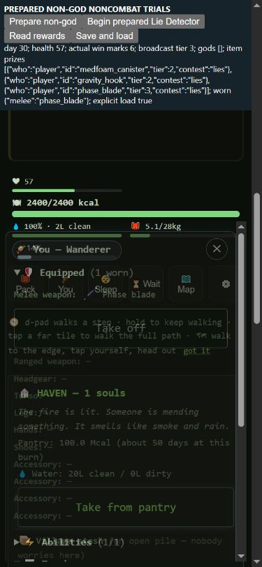

# Contest rewards: honest victory credit and passive tracing

2026-10-16. Base `7af49aa5c5aee94a5b81eab35b81a78a1b411911`, branch
`codex/resume-claude`. Retain the factual accounting repair with
`[needs-eyes]` for its measured balance tradeoffs. No compensating prize,
survival, XP, god-gate, risk, policy, region or nomad change. Seven authored
deeds/three proxies and the Garden/reactor questions remain open.

## What the earlier gear gap actually showed

Between's caregiver10018 comparison was not a controlled comparison of the
same victories. The proxy-god arm won Sweet Tooth83, Hardened Duel86 and
Lie Detector88, receiving real tier3 items. The non-god arm lost Pit80,
Pit82 and Blood Tithe93; NPC co-winners received their actual prizes,
including Raj Patel's tier4 second_skin_suit82. Tier requests use the
existing wave/win/favor/risk rules, not a godhood requirement. There is no
demonstrated prize-denial defect in that pair. Different contest outcomes,
schedule and RNG paths matter, as does the earlier94 versus131 ending.
The pre94 gear gap is real and is not explained solely by shorter exposure.

The passive trace found a separate actual defect. Authored climax choices
carried `do.notability: contestWin` before terminal resolution. Successful
choices got another mark at the real win; a truthful climax could lose a
moot and still get a victory mark. In the historical proxy arm,11 actual
player win terminals generated17 marks. That is not14 player wins: the old
gear observer's14 wins included NPC outcomes. Explicit actor/recipient and
actual versus recorded wins must stay separate.

## Narrow correction and tests

`contestChoose` now defers that phase cue. The existing actual winner
settlement owns its one mark. All other phase notability, winner XP,
casting/prize formulas and rates remain. NPC results already credit real
outcomes; player accounting now follows the same rule. Old save ledgers are
not reset or reconstructed from incomplete history. Correcting new marks
changes casting weights, tier eligibility and subsequent RNG paths.

Initial10-check RED:7 passed/3 failed. Expanded current21-check RED on the
frozen baseline:15 passed/6 failed. Candidate21/21 passes, including real
catalog Lie Detector wins, a low-trust catalog medium-risk Moot loss,
nonterminal cue, ordinary other rhetoric, three real wins reaching broadcast
tier2 and a real watched NPC outcome. The first exploratory test incorrectly
expected fireContest to enter immediately; it announces a countdown. The
proof uses the actual contestInterruption entry. Repeat tests handle real
adaptive phases rather than assuming old choice labels stay available.

The passive observer has10 separate checks: state neutrality, original
return/exception identity, exact call counts, nested parent linkage, explicit
NPC recipient, bounds/filter disclosure and restoration. Full971/971 and
quick199/199 pass. The later strengthened catalog-Moot fixture also passes
in the independently rebuilt root; the Game/policy manifest stays identical.
Both tests join the normal quick/full discovery hooks.

## Reusable measurement

`scripts/contest-reward-observer.js` wraps actual contest/show calls and their
real tier, loot, favor and win-credit children. It does not call game getters,
hydrate people, query modifier helpers, or draw RNG/clock. It captures the
public choice, actual phase/standing, actor state, explicit prize recipient,
requested tier/chance, delivery and return. An active ac.participant of
player can coexist with an NPC co-winner prize: use the actual recipient
argument, not the active participant. Calls outside these contexts are not
a global feature-usage denominator.

`scripts/contest-reward-audit.js` runs one standard seeded campaign per
process, with root/policy/seed/days/output controls. Existing outputs are
refused. It pins normalized211-entry Game/policy/harness sources and nine
raw collector/diagnostic files. The standard balanced observer stays on;
`--observe 0` disables only the new diagnostic trace. Default tracing includes
all actual days, even an action crossing the150-day driver limit. Explicit
day filters use method-entry day; dropped/error records invalidate a full
trace claim. Missing methods and filters remain visible.

The source packet overlays final passive tools, focused tests and the
calendar-window helper outside the211-entry Game manifest, identically in
both arms. These explicit measurement/validation overlays did not mutate
frozen Game/policy/harness sources or the original seven standard collectors.
Reconstructed candidate21+10 checks pass and its capable1 standard child
matches the entire original child result. Diagnostic on/off caregiver10018
traces match both arms' whole raw rows, balanced observations, warnings and
hashes. The historical proxy trace also matches its original standard case.
Source-keyed screen resume reuses all68 jobs.

##16/64 panels: all23 metrics, no weighted score

Same four standard policies and150-day horizon, distinct16-seed screen and
64-seed holdout.656 retained standard workers =328 new candidate plus328
exact baseline reuse from Between after report/jobs. Baseline manifests and
raw collector/contract fingerprints match. Keep screen and holdout separate.

| Cohort/policy | Wins | Player deaths | Community losses | Earned player tier3+ gear |
| --- | --- | --- | --- | --- |
| screen capable |12→16|18→23|2→0|16→16|
| screen maker |4→4|20→15|5→4|16→16|
| screen merchant |4→9|18→16|6→4|16→16|
| screen caregiver |8→7|10→7|4→2|16→16|
| holdout capable |47→44|89→76|14→12|64→62|
| holdout maker |21→21|79→85|20→23|64→61|
| holdout merchant |22→25|57→54|28→24|62→61|
| holdout caregiver |34→33|43→41|15→16|63→63|

Both complete [screen](contest-credit-screen-score.md) and
[holdout](contest-credit-holdout-score.md) say review_required. Holdout
capable entry/class/gear, maker first-bearer survival/deaths per time/
community/class/gear/contest-show gear and caregiver entry warnings remain.
Screen capable wins16/16 coexist with more deaths and lower class access;
do not optimize for that screen or treat the holdout's lower wins as a defect
by themselves. Correct accounting is not proof that broad balance is solved.

Fixed calendar windows retain competing endings and incomplete pairs.
Holdout complete pairs by windows2–30/31–60/61–90/91–120/121–150:
capable53/57/48/4/2; maker52/61/59/25/6; merchant54/61/57/22/2;
caregiver55/61/60/15/4. These are conditional survivor samples, not estimates
of what ended worlds would have done afterward. See the two window JSONs.

## Exact cases and scope of explanation

All64 screen and253 holdout hashes change. The locked replay rule selects
every changed raw row/metric/class/god identity or contest/show/fan delivery,
plus first/last remaining changed hash per policy/cohort; select all hashes
when at most32.276 pairs/552 replays match whole standard results, warnings
and full gameplay hashes. The other41 changed hashes remain unclassified.
Do not discard counter/telemetry fields or call these changes metadata-only.

An additional rule selects first lost win, gained win and lost tier3+ gear
per policy/cohort, deduplicated:17 pairs/34 source-bound reward traces. All
candidate traced player marks equal actual unique player win terminals.
These are targeted diagnoses, not34 additional independent samples. Three
forensic traces, two diagnostic-off controls and one independent rebuilt
standard child are also retained (592 diagnostic campaign executions total,
in addition to the656 standard retained workers).

- Maker10017 retains six actual player victories and the same day97 win.
  Baseline has ten marks; candidate has six. Baseline receives tier3 contest
  starfall_bow44/harvest_scythe46 and later fan/show gear; candidate receives
  no player tier3+ gear. This clean matched-duration gear loss is an eligibility
  tradeoff of removing unearned credit, not proof that the new ledger failed.
- Capable10025 keeps three actual wins, the same deaths20/32 and community
  loss43; marks6→3 and the old fan-package ghost_camo41 disappears.
- Maker10018 loses a win108→community loss113 while the first bearer actually
  lives longer84→103. The new death is a real televised “Take the handicap”
  choice, recorded as contest in the fallen ledger. No automatic survival
  buff or deliberately forced succession is used to recover the ending.
- Capable screen2 changes no-win150→win94 with a combat death93; merchant
  holdout10002 changes no-win149→win118 with a combat death108. More wins
  cannot stand in for bearer survival.
- Caregiver10015 changes win113→community loss133 with no player death in
  either arm; later NPC losses are recorded. The human community metric
  must remain alongside the office's survival and win metric.

The original caregiver10018 non-god gap remains a different issue: current
baseline and fixed arms both have three actual player win terminals/three
marks and the same day94 win. Fixing the separate counter defect is not a
claim to have repaired that person's contest luck or schedule.

## Prepared native noncombat reward-to-use proof

390×844 phone: Charlotte starts godless with no magic kit, funded Haven and
zero win marks. The fixture begins repeated prepared catalog Lie Detector
trials; it does not simulate natural broadcast frequency. Actual native
Participate/rhetorical choices, adaptive banned moves and a hurt handicap
remain in effect. Native Wait advanced128ticks to display the first prepared
modal; later native You/Close refreshed the modal without another wait.

First truthful win gives one mark, not two. Three real wins give tier2 and
real beans/medfoam rewards. Six wins give six marks, tier3 and an actual
Phase blade. Health100→57 includes normal winner costs and the actual
handicap. The first System prize offered a normal ability sheet; Translator
was accepted in one earned slot, later offers were kept. No god was granted.
The adaptive phase changed labels/stipulations; absent old selectors were
inspected and corrected rather than bypassing the rules.

The blade appears in native Pack. An initial Equip attempt was covered by a
pending earned Social level-up sheet, not a broken equipment handler. After
resolving Keep, native Equip puts it in melee; native You shows one worn item
and Phase blade. Save→erase live equipment/win ledger→actual load restores
six marks, tier3 and the equipped blade. This establishes delivery/use without
godhood or combat acquisition. It is not a natural cadence, all-playstyle
viability, no-magic-ever, or guaranteed-prize claim. Server/tab are closed;
no SW/version bump or player deployment.

## Handoff and remaining work

Use the public CLI against immutable roots, compare entire standard results,
and retain explicit trace bounds. The dated compare/replays/watch/diagnose/
reward-summary/controls/verifier tools reproduce this unit. Reconstruct with
`contest-credit-reconstruct.cjs before|after <fresh-root>`; verify using
`contest-credit-verify.cjs --collector-root <rebuilt-root>` after future
collector changes. The receipt seals proof/tool/audit bytes; verification
output is outside the seal. Never overwrite sealed outputs; use a new prefix.

ROADMAP, SIMULATING, SURVIVAL-LEVERS, AGENT-LANES and MEASUREMENT-PLAN are
updated together. Keep investigating NPC class/build composition, deliberate
peaceful strategies and natural broadcast opportunities; use truthful wins
and actual recipients before adjusting reward rates. Remaining deeds,
scale/parity, natural Finale/Network closure and the wider roadmap stay open.
