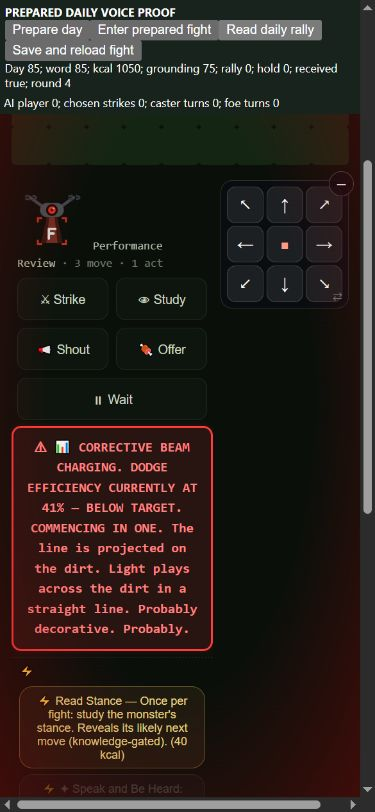

# Daily Voice: the player hears the paid word

Retain the tactical recipient repair on `codex/resume-claude`; feel review
requested. Base `7eda88803cb1e0d9fc974bae03b849c565694bc6`. One runtime input
changes: godverbs.js. Costs, magnitudes, policies, observer and23-metric
contract stay fixed. The next bot preparation experiment is separate.

## What was missing

The existing Be Heard action promises that every fight today starts rallied.
It pays150kcal and five grounding once per day and records village.voiceDay.
The old consumer only wrapped tbVillagerTurn: NPC allies, including late
arrivals, received it, while the actual player turn never read it.

The shared dailyVoice hook now runs before both real own-turn entry paths.
It sets the existing four rally/hold counters before their normal decrement,
preserving three active turns and the existing raw+4 player damage convention.
The player receives the day's word too, including when they are the payer;
this follows the existing action's every-fight promise and is a feel-review
point. It grants no command or next-strike multiplier. Other chosen abilities
still pay their normal price.

The existing fighter `_gvVoiced` receipt permits one grant per fight. Stronger
existing rally survives before normal ticking. Real bonus turns and stun spend
duration, and another same-day fight receives its own finite grant. A new fight
after dawn needs that day's word. Save/load already serializes the entire
fighter, so remaining counters and receipt persist without a new save field.
Dead, fled, hostile, detached and current-bearer NPC-alias recipients cannot
acquire the allied effect. No new telemetry or clock read is introduced.

## Runtime and native phone proof

`scripts/godpath/test-daily-voice.js` uses one shared-kit harness and real
paid useAbility, fight constructor, turn drivers, damage, dawn and save/load.
It passes25/25. The same proof on the frozen baseline fails15 assertions
(10 pass): actual player delivery, damage, expiry, saved/bonus/stun paths and
invalid NPC recipients are caught. Assertions are preserved. Quick177/177;
full949/949. check-wired reports60 functions and zero unwired in godverbs.js.
Frozen final reconstruction also passes25/25.

Final-source browser390×844, authored fixture provides access only:

1. Native Speak and Be Heard pays1200→1050kcal and80→75 grounding. The button
   becomes unavailable for the day. No preparation button pays the ability.
2. Prepared encounter calls the real constructor. Before player input, the
   existing controls open with rally3/hold3 and a named daily-word line.
3. Native Study spends the action. Actual Save and reload fight preserves
   rally3, received=true and zero acts; it does not tick or refresh the buff.
4. Native Wait reaches round2/rally2. A native south step moves off the
   projected review-drone beam; further Wait reaches round3/rally1 and
   round4/rally0. Food1050 and grounding75 remain unchanged throughout.

Full AX snapshots and screenshots are retained. This is prepared access,
not natural acquisition, a human campaign or proof of NPC field/performance
contexts. The current runtime repair covers tactical own-turn recipients.
NPC daily casting/planning, class aura opening/late injection, same-day allied
village communication, performance contests and broad NPC feast/social parity
remain separate work.



## Source-bound campaign measurement

Frozen baseline matches all207 normalized runtime/policy/harness inputs in
the grounding unit's final panel. Reuse that immutable baseline only after
this check.16 then64 standard seeds per capable/maker/merchant/caregiver,
150 days, Columbus origin, same policies and Node flags. Final candidate
reuses all68 screen jobs; it retains260 jobs including four observer-off
controls. Baseline260 jobs are referenced from the preceding unit rather
than copied. Both sources stay stable, sampled observer-on/off rows and full
hashes agree, and warnings/observer/gear errors are zero.

All256 rows, final gameplay hashes and23-metric sets are exactly identical.
Wins stay57/18/24/23; existing community/death/class/gear tradeoffs are unchanged.
The comparator reports no_material_signal for every cohort. This is evidence
of the measured unchanged results, not a claim that the repair is useful in
ordinary campaigns or that these policies cover every playstyle. No win-rate
target, price adjustment or compensating buff is used. Full comparison:
[daily-voice-compare64.md](daily-voice-compare64.md).

## Feature-use diagnosis: paying is not receiving tactical value

Four named, naturally acquired Voice-holder cases were replayed before/after,
with passive snapshots around actual ability listing/use and fight entry.
All eight traces reproduce their panel's source digest, row, full hash and
23 metrics exactly. The public probe also reproduces the final capable7 case
from a reconstructed source capsule. It adds no action or helper query.

| Policy / seed | Actual accepted Be Heard casts | All fight starts | Starts under that day's word |
| --- | ---: | ---: | ---: |
| capable7 | 11 | 20 | 0 |
| maker10 | 70 | 46 | 0 |
| merchant4 | 10 | 6 | 0 |
| caregiver10 | 11 | 6 | 0 |

These102 accepted casts still spend actual food/humanity and deliver the old
trust effect. They are not a zero-use feature. Their tactical component sees
zero same-day fight starts in these four cases. Do not generalize this named
sample into an all256-campaign cast census.

In capable7, the actual day80–90 daily casts each pay150 and five grounding.
Three day90 fights start under day89's marker, before day90's cast. Source
explains a sequencing opportunity: capable.upkeep can trigger deedHunt/raid
encounters, while godDay currently runs in capable.daily afterward. Maker10
keeps paying through day149; paying often alone does not establish combat
coverage or benefit. Prepared tests and identical campaign hashes therefore
answer different questions.

Next experiment: investigate known public goals, food/humanity and visible
encounter timing before changing daily preparation policy. Preserve a paired
unchanged-policy control, equal-time exposure and holdouts. Do not force
peaceful makers/caregivers into fights simply to exercise the repaired buff,
or move every god action blindly ahead of meals/maintenance. The relay-office
roadmap already asks for goal/food/grounding-aware preparation; this supplies
concrete timing evidence for that work.

## Reproduce and keep current

```text
node evidence/2026-10-16/daily-voice-verify.cjs
node evidence/2026-10-16/daily-voice-verify.cjs --current
node evidence/2026-10-16/daily-voice-reconstruct.cjs before <fresh-before>
node evidence/2026-10-16/daily-voice-reconstruct.cjs after <fresh-after>
node evidence/2026-10-16/daily-voice-probe.cjs <fresh-after> capable 7 <trace.json.gz>
node evidence/2026-10-16/daily-voice-server.cjs <fresh-after>
node scripts/godpath/test-daily-voice.js
```

Default verification checks frozen evidence and the exact baseline inputs;
`--current` also checks current source and runs25 assertions. Reconstruction
requires the pinned base commit locally, rejects existing destinations/tars,
installs the proof in both arms, and checks all207 manifest entries with no
own.git. Adjacent tar is retained. Frozen archives omit optional art; the full
checkout supplies identical art. The loopback server exposes the labelled
fixture at127.0.0.1:8771/proof. Normal quick/full discovers the focused test.
Maintain actual paid action, first real own turn, damage, save/expiry, bonus,
stun and invalid recipient coverage together. Update SURVIVAL-LEVERS.md and
the named opportunity diagnosis with any cost/timing/policy follow-up.
