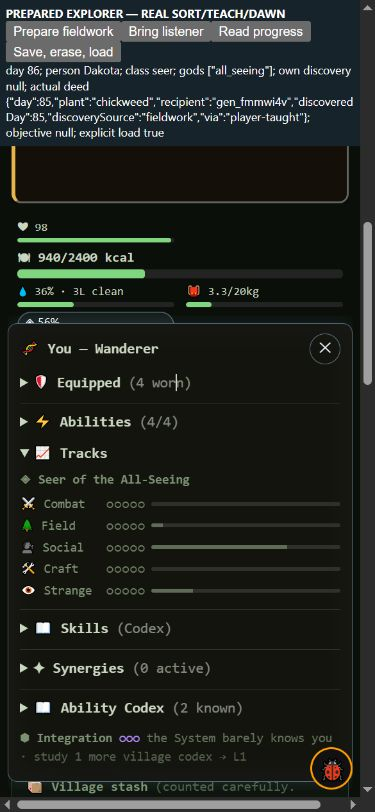

# Explorer deed and personal memory — needs eyes

This branch replaces Explorer's remaining synergy proxy with an authored,
person-owned outcome: **discover a plant firsthand, then successfully share
its true identity with a distinct person who did not know it**. This is an
Agent-authored interpretation for Seer and Cartographer, not a Steve quote.
The class, payoff, four magic, day80 and existing active-god rules remain.
Eight paths now have authored deeds; Garden and Builder remain proxies.
Garden's seven-day diet and reactor-versus-food-use questions remain open.

Actual solo sorting, three-look NPC examination, ordinary assigned forage,
player cautious/rushed testing and public NPC experimentation can supply
firsthand discovery. Teaching requires a real landed identity: conversation,
direct instruction, sorting instruction, fireside, an immediate witness or
word of mouth with its actual speaker. Books, gifts, prior shared records,
bare knowledge-store writes, partial unnamed nibbles, false names, failed or
redundant lessons, absent/dead recipients and inherited discovery do not
substitute. A public experiment belongs to its actual tester; watching it
does not invent the bearer's own fieldwork. Costs and odds stay unchanged.

Prepared NPC discovery→death→mantle→teaching exposed a prerequisite bug:
plant knowledge did not follow its actual person, although ability knowledge
did. The successor now remembers their actual personal plant union as level1
names. Correct deeper written knowledge remains; honest mistaken memories
stay mistaken, deliberate liars retain the real identity, and genuine
correction uses the existing contested-name path. No discovery, witness,
XP or integration is minted by importing memory. Personal unfinished work
follows that same person; a different successor cannot borrow it.

## Measured changes

Five frozen211-entry Game/policy/harness roots retain the whole investigation:
published `before`, `memory` only, first `after` draft, `complete` assigned-
forage correction, and `final` testing/experiment coverage. The two earlier
deed candidates are limited drafts. Original bundles/manifests are preserved;
later bundles pin predecessor bytes. Identical validation overlays are outside
the211 Game manifest. The seven raw collector/contract files are identical.

Each arm uses the same four standard policies,150 driver iterations,
16 fixed screen seeds and64 disjoint holdout seeds:328 workers including
observer-off controls. Total1,640 workers;328 baseline workers reused and
1,312 newly run. All23 metrics, eligibility, warnings, gear and NPC exposure
remain available in the ten contrast scorecards and final summary. Contrasts
share samples and are correlated. There is no weighted acceptance score.

Holdout counts below are **before / memory / final**, out of64 per policy:

| Policy | Wins | Table entries | Bearer deaths | Community losses |
|---|---|---|---|---|
| capable |44 /49 /49|44 /49 /49|76 /79 /79|12 /8 /8|
| maker |21 /22 /22|22 /23 /23|85 /83 /81|23 /21 /20|
| merchant |25 /25 /25|26 /26 /26|54 /59 /60|24 /25 /25|
| caregiver |33 /32 /32|34 /33 /33|41 /45 /46|16 /14 /14|

The screen differs: capable wins16→14 alongside deaths23→27 and community
losses0→2; maker community losses4→5; merchant class access13→12.
Holdout maker class access47→44 remains a warning. The memory→final screen
has caregiver Table entries11→10; its holdout aggregate has no material
signal under the existing thresholds, despite13 changed raw rows/metrics.
Neither a higher win count nor `no_material_signal` settles survival quality.

The added assigned-forage and testing/experiment coverage leaves every
standard raw row and complete balanced collector result unchanged relative
to the first deed draft. New personal ledgers and telemetry still change
full state hashes and are retained. Locked replay selection covers every
changed hash for contrasts with at most32; otherwise every changed row,
metric, class/god, full gear or NPC exposure plus first/last per policy.
Unselected hashes remain explicitly unclassified. `explorer-deed-diagnosis`
retains selected complete-state diff paths, ending/death sequences and
conditional fixed-calendar windows; it does not extrapolate classifications
to unselected campaigns. Only three wall-clock pacing fields are excluded
from the full-state hash.

The locked union uses921 unique full-state replay workers (222 screen,
699 holdout), shared across correlated contrast plans rather than counted
again as independent samples. For complete→final, the screen selects8 of64
changed hashes and holdout8 of250;56 and242 remain unclassified. A300-event
telemetry ring can evict an older event when a new deed arrives, so filtered
telemetry alone cannot always prove equality; those cases remain conservative.

One warning illustrates why wins are insufficient: capable screen seed1
wins in both published and memory-only arms, yet deaths rise1→5. Both first
die in combat on day43 and select Ethan Hunt. The first mantle snapshot
imports his Sassafras, European hazelnut and Pawpaw in the memory arm; the
published arm imports none. Later combat deaths occur on67/83/86/87 in the
memory arm. This locates a visible knowledge/succession fork, not a complete
causal explanation for every later decision or a reason to erase memory.
Keep the warning for targeted food/build/encounter-policy investigation.

## Access and native playtest

Standard sampled player All-Seeing campaigns fall from18 across the two
baseline cohorts to zero in the final320 campaigns; NPC All-Seeing is zero
in both. Adding omitted legitimate callers does not recover standard god
access. `formerSight` in the diagnosis retains the final histories for prior
god campaigns. A campaign union is not the same person's final class, kit or
opportunity. Next measure a declared Explorer strategy using knowledge-bound
discovery and teaching choices, with opportunity denominators and all23
metrics. Do not waive the deed, globally reorder kits, force death or buff
survival merely to restore this count. Generic policies are not every
human playstyle; zero usage is not proof of impossibility or natural viability.

Capable screen seed9 is a concrete gate-access example: the same original
bearer keeps Cartographer since45 and the four Explorer magic through90 in
both the published and final runs. Published ascends on80. Final has no own
unfinished plant discovery or completed Explorer deed, although other people
earn public-experiment/word-of-mouth deeds. The new outcome, rather than
missing kit in this example, prevents the old proxy ascension. A deliberate
Explorer needs to discover and share before all identities arrive from other
people; the deed can be earned before class recognition and does not expire.
This is one traced case, not a causal explanation for all former god campaigns.

The final-source390×844 native fixture prepares day85, valid four slots,
Seer kit, healthy food reserve, unknown Chickweed and an uninformed listener.
Dakota uses **Test cautiously**, then native Talk/answer/**show something I
learned** to teach Luna. The actual deed lands at85. Four actual Wait actions
reach86, All-Seeing ascends and Truth Lenses appears in Pack. Save→erase live
ledgers/godhood→load returns true and restores progress. The served Godpath
SHA is `b3499824e3e71e665797763485b8d50f3428962f0ee1f38f0f7839975b984506`.
The fixture banner says SORT/TEACH/DAWN; the retained actual control trace
uses cautious testing. Truth Lenses is a utility gift with no Wear control;
this is not proof of equipped tier3 combat gear or natural acquisition time.
Earlier Sort proof belongs to the limited first draft and stays historical.

## Repeatable handoff

Four ordinary shared-harness suites provide75 real-caller assertions:
38 deed,15 mantle memory,8 assigned forage and14 testing. The testing suite
was9 pass/5 fail on the frozen prior candidate and14/14 after repair. Final
full976 and quick204 pass. The archive reconstruction reruns all75 checks
and a whole campaign child; an additional observer-off full-state child
checks neutrality. No replacement Game rules or fake outcome stubs are used.

`node evidence/2026-10-16/explorer-deed-verify.cjs` checks the sealed raw files,
source/collector identities, cached jobs, observer neutrality, all23 scores,
locked replay plans, whole raw rows/collector objects/full-state hashes,
reconstruction, validation logs and native checkpoints. Recompute summaries
with the final-summary/analyze scripts' `--check` mode. Never rerun a freeze
or overwrite this receipt; create a newly named candidate for later changes.

Muse can use `codex/resume-claude` and the shared commands in SIMULATING.md.
No main merge, deployment, version/SW bump, policy change, global starter
reorder or Muse region/nomad edit is included. The broad roadmap remains open,
including All-Seeing contest/army effects, NPC investigation, dedicated
Explorer strategy and the two human questions above.
