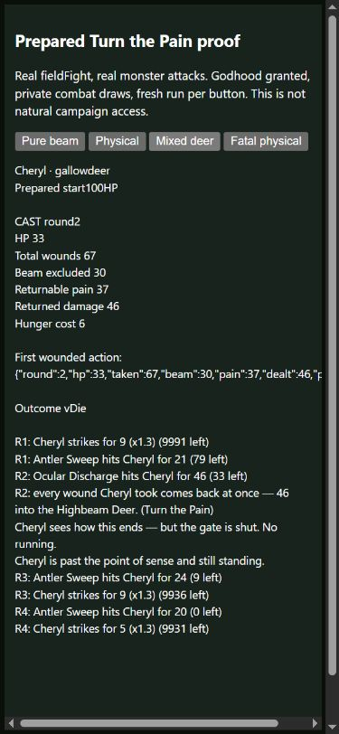

# Turn the Pain: off-screen light and living delivery

2026-10-16. Baseline b4f6e7750704dc1b40b1b95c69c7726acedae297.
Retain the documented weakness/cost correction. Mixed aggregate-hit
attribution is an Agent design judgment marked needs-eyes.

## Actual defects and repair

Tactical painPool subtracts actual landed beam damage from cumulative
wounds. The field caller previously supplied only aggregate rec.vTaken,
so One-Person Army returned beams as well as physical wounds. The field
engine could also call the god action at nonpositive HP before its normal
end-of-round death check. That violates the existing requirement to survive
to deliver the return. These are related contracts, measured together here;
do not attribute every possible outcome change to only one.

fieldFight now keeps a local vBeamTaken counter. A selected physical attack
from a beam species stays physical. Misses, god/ability absorption, armor,
brace and shield-wall reduction are resolved before crediting the actual
bearer hit. Ally-targeted damage is not the bearer's wound. Gross vTaken is
unchanged for health settlement, morale, scars and logs. No new saved state,
telemetry event, random draw or game-helper lookup is introduced.

The field model resolves deer beams plus physical antlers as one aggregate
hit. The counter apportions final integer harm in the ratio of its original
beam/physical components, with physical receiving the rounding remainder.
Pure beams are exact (all final harm excluded); pure physical hits exclude
zero. Mixed attribution is an explicit interpretation, not a claim that the
field model resolves armor on two separate tactical hits. Hit damage,
absorption and market coin behavior themselves are unchanged. The existing
special signature damage models are not universally re-authored here.

The god field action subtracts this counter for both its trigger and return
amount, clamps the pool at zero, and requires current HP above zero.
Its35percent-maxHP trigger,150kcal-equivalent price, power multiplier,
one cast per fight and uncapped physical return remain. Hunger/payment
gates remain. A later living action after an actual death refusal is a
different boundary. Ordinary field strikes can still occur before the
round's separate death settlement; this unit does not claim to repair all
posthumous actions, all gods, or headless player field-contest parity.

## Runtime and phone proof

The new shared-kit test has22 passing assertions; the exact frozen baseline
passes9 and fails13. Several baseline failures are predicates for the new
local context field, not13 independent gameplay defects. The real field
caller is tested with existing review_drone, hushwolf and gallowdeer data,
private combat RNG and prepared NPC godhood. Coverage includes pure light,
physical payment/action consumption, one-use limits, selected antlers,
mixed return amount/threshold, post-armor/brace wounds, dodged beams,
ally hits, hunger and fatal delivery. Actual tactical player and NPC
tbDamage callers provide the same beam/physical controls. No damage hook
is replaced with a fabricated outcome; wrappers observe/delegate once.

The390x844 browser proof uses a prepared viewer with authored fixture
buttons, not new production UI. Each button creates a fresh run, grants one
resident One-Person Army, clears that resident's equipment and ordinary
ability/skill lists, and calls the real fieldFight with real attacks and a
large target-health stress fixture. Combat draws are private/fixed; browser
roster generation is not claimed deterministic. No natural acquisition or
human campaign claim is made.

Pure drone beams produce no retaliation/payment. Physical hushwolf damage
returns36 wounds as45 powered damage and charges6 hunger. The mixed deer
example has67 total wounds,30 beam excluded,37 physical pain and46 powered
damage, charging6 hunger while still alive at33HP. Starting a separate
resident at40HP against physical antlers produces fatal damage without a
posthumous god cast or payment. These prepared stress fights still lose;
the target's10000HP is intentionally not a natural victory demonstration.
The actual source record and visible logs, not the game's starting-screen
day label behind the overlay, establish the prepared fight day85.
The owned tab/server were closed and temporary viewport reset.



## Campaign measurement and opportunity limits

Four standard policies (capable/maker/merchant/caregiver),64 matched seeds
each,150 loop days, Columbus origin, default flags, same current collector,
contracts, policy and harness revisions. Baseline cache reuse is validated
against exact source/observer/contract and result digests, never re-keyed.
All207 fingerprinted source files are stable.520 distinct verified jobs
comprise512 campaign rows and eight off controls: eight on/off pairs across
two roots/four policies. Screens derived from these rows are subsets, not
additional independent experiments or a separate holdout.

All256 campaign result rows, all23 metric sets and final canonical gameplay
hashes match. The retained comparison reports no_material_signal; this
describes these samples, not a broad harmlessness/balance claim.

| Policy (64 seeds) | Wins (same) | Player deaths (same) | Community losses (same) | First bearer through60 (same) |
|---|---:|---:|---:|---:|
|capable|55|92|8|34|
|maker|18|57|19|53|
|merchant|25|44|14|57|
|caregiver|24|49|16|54|

The raw panels retain gear sources/tiers, recipe opportunities, calls/effects,
classes/gods, intake, resource distress, events and endings. All256 cases
earn player T3+ weapon/armor; contest/show cases are252/256 and craft/trade
T3+ remains unsampled. No sampled NPC One-Person Army god appears; maker26
samples a player Army god, whose tactical rules are unchanged. Daily god
sampling is not continuous ownership and cannot prove no transient holder.
No affected-build campaign balance estimate or independent holdout is claimed.
The unanswered introductory knack policy limitation remains documented.

A separately labelled maker7 campaign grants one actual resident Army god
at setup in both roots and otherwise uses the ordinary policy. It directly
sets no class/XP/HP/food/win. Each root's observed run matches its off control
in row/full hash: four diagnostic jobs, two neutral pairs, zero warnings or
dropped records. Lorenzo has19 recorded god-holder field fights and two
real physical casts (hushwolf33 and eulogy91), but no recorded beam/deer
encounter. Rows, fight records and final hashes match across arms. Both
villages are lost109 with combat and starvation player deaths. This proves
continued paid physical use in a prepared campaign, not affected light
exposure, natural access or improved human viability. Prepared beam/mixed
runtime and browser fights establish the corrected weakness instead.

Keep the repair because it enforces the authored weakness and living cost,
not because of a win-rate movement. No compensating buff or easing of the
Table. Broader scale/recipient and authored-deed work remains open.

## Full-suite triage and reproduction

Quick170/170. First full run941/942: the known unseeded legacy
test-drifter-grab-20261006.js failed distant-village catch-up/pantry checks.
Its explicit module list never loads either changed module. Source is
unchanged; both frozen roots pass all11 assertions with the same pre-eval
seed7. Earlier independent baseline reproduction of the same failure is
documented in storage-worksite-audit.md and peer-league-audit.md (2026-10-15).
The test's road helper can stop short on random maps; deterministic fixture
repair remains a known-issues follow-up, not hidden by a quarantine or
weakened assertion. Final full recheck942/942 passes in172s. Both full logs
are retained; this is not presented as an uninterrupted green history.

Ontology111 systems passes. Static fieldFights7/godverbs59 functions have
zero unwired flags; actual runtime assertions establish these changed
callers. Static wiring does not establish all forty promised scale effects.
Core measurement files are unchanged, so balance-proof.json is not replaced.

```text
node evidence/2026-10-16/field-pain-reconstruct.cjs before <fresh-before>
node evidence/2026-10-16/field-pain-reconstruct.cjs after <fresh-after>
node <fresh-after>/scripts/godpath/test-field-pain-beams.js
node scripts/balance-panel.js --root <root> --policies capable,maker,merchant,caregiver --n 64 --par 6 --out <panel>
node scripts/balance-panel.js compare --before <before-panel.json.gz> --after <after-panel.json.gz> --out <comparison>
node evidence/2026-10-16/field-pain-replay.cjs <root> maker 7 on <replay.json> prepared
node evidence/2026-10-16/field-pain-verify.cjs
node --require ./evidence/2026-10-16/field-pain-drifter-seed.cjs <fresh-before>/scripts/test-drifter-grab-20261006.js
```

Use off for the diagnostic control. Both fresh reconstructed roots reproduce
maker7 rows/hashes and on/off controls (four fresh jobs); the reconstructed
final runtime test also passes22/22. The helper refuses existing output and
verifies all207 source hashes. Source roots have null HEAD metadata, never
the moving outer repository's HEAD. Exact sources, both proofs, raw panels,
identity/result checks and artifact hashes are retained for Muse. No release,
master/main push, merge or service-worker bump accompanies this work.
