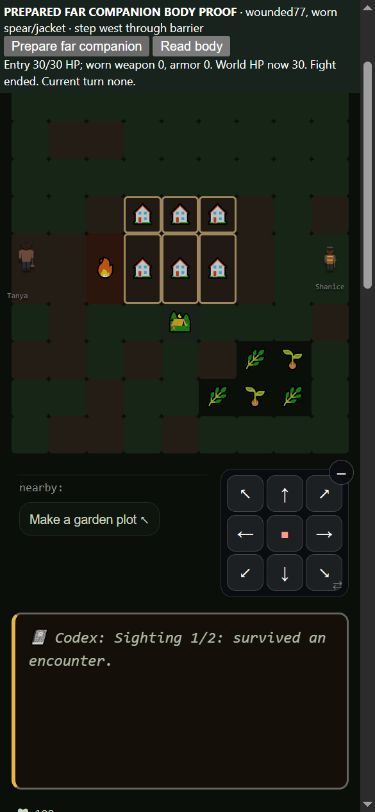
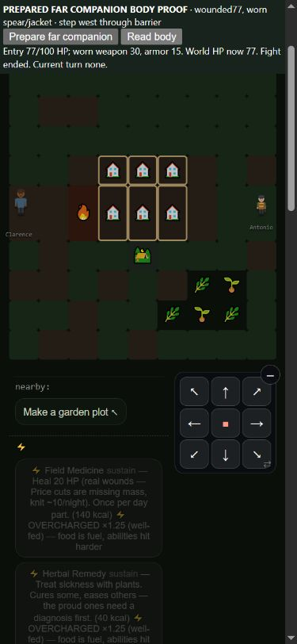

# Formal companion body audit — measured, not adopted

2026-10-16. Base `ecba851d592addc47f50d821634785bf58af1133`,
`codex/resume-claude`. **Published gameplay, policies, observer, contracts and
tests remain at that baseline.** The candidate lives in the source bundle,
not the runtime tree. No merge, deployment, release or service-worker bump.

The candidate repairs a real body/gear defect, but fails an existing food-use
integration test. Preserve both facts. Winning should be difficult: its higher
win rates neither justify adoption nor establish a suitable challenge level.
No enemy, health, food, offer or policy tuning was added to recover a target.

## Actual defect and isolated candidate

Nearby monster and alien companions already use saved world HP, default100,
capacity at least100, and actual worn melee weapon/armor calculations.
`party.js` still creates two different30HP helpers without those gear fields:

- Formal companions missing from the nearby monster builder, including
  missing positions, beyond-radius members and members outside its quota.
- Loyal party members in a betrayal fight, excluding the actual betrayer.

The existing `tbEnd` world-wound settlement makes the inconsistency persistent.
A real no-hit escape changes77→30; an injured9HP person instead heals9→30.
Twenty incoming physical damage lands against30 and persists10 rather than57.
The surrogate capacity also limits actual Molt recovery to30.

The candidate changes **only `src/js/party.js`** in the207-file source manifest.
A private shared snapshot copies the existing nearby formula: saved rounded
HP with the existing minimum1/default100, max capacity `max(hp,100)`, existing
default melee `weaponBonusOf` and `armorOf` applied to the actual person.
It reads worn equipment; it does not equip, acquire, craft or invent gear.
The existing half-weapon helper-strike rule remains in the real damage caller.
Missing definitions retain zero gear. Background people have a definition
fallback. No added random draw, clock read, food cost or telemetry event.

This combines real HP, capacity and gear parity. The campaign experiment does
**not** isolate their separate effects. Existing membership/canonical-person
guards, placement, missing-position fallback onto the player, nearest-four
rules, late injection/initiative recomputation, costs and hostile betrayer40HP
model are unchanged. The zero-health minimum1 behavior is inherited from the
nearby builder, not a new living/dead eligibility correction. Alien formal-party
entry is still a separate constructor contract. No universal parity claim.

## Meaningful runtime and phone proof

The common retained `test-formal-companion-body.js` uses the shared kit,
one seeded harness per process, real monster/betrayal constructors, real
damage/strikes, Molt, death and escape settlement. Entry snapshots temporarily
pause opening advance; they do not certify initiative scheduling. Strike proof
observes the actual roll range and landed damage, avoiding a false pass from
an unrelated flank multiplier. The same proof reports **4 passed/24 failed on
base;28 passed/0 failed on candidate**, including default/above-normal capacity,
canonical duplicate/self exclusions and actual dead-body settlement.
See runtime-before/after.txt. The proof is bundled for reconstruction; it is
not added to the main green list against knowingly unchanged buggy gameplay.

Native390×844 phone runs use the same explicit prepared conditions: a77HP
formal companion beyond four squares, worn spear/jacket, player at the west
edge, adjacent Haven. Click Prepare, then the actual d-pad **step west**, then
Read body. The real barrier/travel/escape path settles baseline77→30 without
an attack; candidate77→77 with weapon30/armor15. There is no scripted `tbEnd`
button or browser hidden-state evaluation. Browser rosters are unseeded and
different; this is a prepared contract proof, not paired natural campaigns.
The fixture changes the local board and adjacent tile explicitly, without
claiming natural access, normal travel cost or a full UI/layout certification.
Retained DOM and screenshots show the entry/settled values. Generated archives
omit the optional version polling asset; its404 is not a game runtime error.





## Matched campaigns and all outcome families

Identical current observer/23 contracts, policies/harness/flags, ordinary
Columbus/eastern-woodlands origin,150 requested driver days (actual calendar
progress retained separately).16 paired seeds per policy
screen, then64, reusing exact cases. **512 source/policy/seed rows,520 distinct
cached jobs**:256 paired correlated policy-seed worlds and8 standard on/off
pairs (4 per root). The16-seed rows are a subset, not extra independent cases.
All207 source fingerprints remain stable; only party.js differs between arms.
No warnings, observer errors or source mismatches. Archives report null HEAD.
There is no holdout or confirmatory small-effect claim.

Counts below are out of64, except total bearer deaths. Policies are mixed
strategies, not pacifist challenges. Every policy's complete23-metric means,
paired tails, exploratory intervals and unknown denominators are retained in
[confirmation.md](formal-companion-confirmation.md) and its raw JSON/panels.
Higher wins do not cancel warnings in class access, food or other outcomes.

| Policy | Wins | Bearer deaths | Community loss | First bearer alive60 | Named class | EarnedT3+ gear |
| --- | --- | --- | --- | --- | --- | --- |
| capable |56→60|93→74|7→2|34→34|48→45|63→63|
| maker |18→22|57→58|20→14|53→50|55→48|64→64|
| merchant |24→25|45→37|17→6|57→61|46→43|64→64|
| caregiver |23→35|48→31|16→9|54→57|48→42|64→64|

Both reports remain `review_required`. Caregiver win movement has an
exploratory interval above zero; this is a challenge review trigger, not proof
of improvement. Capable invitation counts fall63→60. All four named-class
rates fall. Maker first-bearer survival/death warnings remain despite fewer
communities lost overall. Capable sampled low-food exposure rises slightly;
do not collapse these resource windows into one total score.

Contest/show earnedT3+ access is62→63 /62→64 /64→64 /64→62. Craft/tradeT3+
remains0 in every policy/arm; that is bot route coverage, not proof a route is
broken. Before/after feature censuses retain all observed method denominators,
calls, recipe readiness and build distributions. None of the256 complete
rows/hashes are equal, consistent with commonly used formal parties; this
does not establish that every changed run exposed both corrected branches.

## Natural tails and the integration failure

Four selected policy/seed pairs replay on/off in both roots: **16 diagnostic
jobs**, each matching its retained standard row/full hash with no dropped
events or warnings. These are selected explanations, not an independent panel.
Read [traces.json](formal-companion-traces.json) and the retained raw replays.
Each first differing entry below contains formal people with **missing saved
positions**; do not describe all of them as physically distant. Their fallback
placement and initiative are unchanged. Later histories cannot be attributed
to HP alone or to a particular later fight without further proof.

- **capable9:** first entry differs12, daily snapshot13. Base has a combat
  death45 and village-lost49 (51 driver iterations); candidate has no bearer death and wins on90
  after one failed bargain. Candidate loses earnedT3+ gear access despite
  winning; overall good-gear equality hides this adverse pair.
- **maker35:** entry33, daily34. Base reaches an Apex ending90 without a
  bearer death. Candidate combat deaths53/56/76 precede village-dead118
  (116 driver iterations).
  This is a substantial adverse tail under the locally more complete body.
- **merchant29:** entry10, daily11. Both reach the150-iteration ceiling without
  a win (final calendar days151/147); candidate adds a combat death32. An unchanged win count misses it.
- **caregiver42:** first differing entry/daily13. Base starvation18 and later
  combat death141 still leave a campaign at the ceiling; candidate has no
  bearer death but reaches village-dead118. Fewer player deaths are not the
  same as community continuity. Its first corrected bodies carry76/86/77HP
  and existing gear, replacing30/30/30; no new ally is added.

The existing `scripts/test-capable-bot-20261014.js` is separately reproduced
unchanged. It passes25/25 on base and fails only its food-deed assertion on
candidate (24/25). Original quick172 pass/1 fail; full944 pass/1 fail. The
focused repair passing28 assertions does not clear this integration contract.

The legacy test's two40-day runs are traced inside the original test execution,
including its existing multi-load setup. This preserves its behavior rather
than recommending multi-load tests. Four executions (both arms on/off) retain
8 terminal rows, four matching on/off full-state/row pairs. Daily snapshots
copy mutable arrays immediately. An early scratch version held references;
its apparent day2 kit differences were invalid and are not published evidence.

On seed42 the first real entry difference is13. Base starvation death is18;
the next daily snapshot shows its successor on19, who uses a feast surge on27. Candidate keeps its initial bearer,
installs the reactor on15 and has no food-use deed by40. Seed1234 installs
on29 base/22 candidate and earns no credit in either arm. This exposes the
**already-pending reactor versus food-use question**, not a new authorization
to remove the reactor, waive the deed or force bot choices. Standard150-day
panels and these legacy smoke-test histories are distinct executions.

Decision: retain the source-bound candidate/evidence, **do not adopt it yet**.
Restore exact published runtime and tests. Restored quick172/172 and full
944/944 are retained separately from candidate failures. This is a test/
progression constraint, not an automatic win/survival verdict. It does not
endorse the30HP defect or block independent roadmap work.

## Reproduction and next work

The [candidate patch](formal-companion-candidate.patch) and
[complete runtime proof](formal-companion-runtime-proof.js.txt) are directly
reviewable. The source bundle contains the exact candidate party.js, common28-assertion
proof and both207-file manifests, against baseecba851d. Reconstruction refuses
an existing output and verifies every fingerprint. Example from this repo:

```text
node evidence/2026-10-16/formal-companion-reconstruct.cjs before <fresh-base>
node evidence/2026-10-16/formal-companion-reconstruct.cjs after <fresh-candidate>
node <fresh-candidate>/scripts/godpath/test-formal-companion-body.js
node scripts/balance-panel.js --root <fresh-base> --n 64 --par 4 --out <base-panel>
node scripts/balance-panel.js --root <fresh-candidate> --n 64 --par 4 --out <candidate-panel>
node scripts/balance-panel.js compare --before <base-panel>/panel.json.gz --after <candidate-panel>/panel.json.gz --out <comparison>
node evidence/2026-10-16/formal-companion-replay.cjs <root> maker 35 on <fresh-replay.json>
node evidence/2026-10-16/formal-companion-short-diagnostic.cjs <root> <fresh-short.jsonl> on
node evidence/2026-10-16/formal-companion-verify.cjs
```

Use off for each diagnostic neutral control. Fresh reconstructions reproduce
maker7 on/off in both roots (4 fresh executions, same cached identities) and
candidate runtime28/28. Fresh maker panels and runtime output are retained.
For the phone, run the fixture generator from each reconstructed root with
`phone.html` as output, serve each on a fresh local origin, Prepare, step west,
Read body. No `.git` creation or inherited outer HEAD is required.

Static party scan is36 functions/1 pre-existing unwired `npcLeavesParty` on
base,37/1 on candidate; the new private snapshot is called from both branches.
Ontology validates111 systems. No universal wiring claim. Text artifacts use
canonical LF hashes, gzip/JPEG exact bytes; the receipt/verifier also checks
job/result identities, panels, replays and source replacements.

Muse can read/fetch `origin/codex/resume-claude` and this audit without
importing gameplay into its regional tree. The shared observer branch stays
at its separately documented baseline. Do not cherry-pick the candidate as
green, refresh measurement fingerprints merely to hide failure, or assume
an evidence-only push deploys it. Existing measurement maintenance hooks stay.

Next: resolve the existing reactor/food-use contract before adopting this
repair; independently audit late formal injection's turn-order/current-turn
consistency and missing-position placement; define formal entry for aliens
and reconcile hostile betrayal separately. Those are not fixed by a stat
snapshot. NPC eligibility/exposure denominators, Voice/brawler recipients,
Garden's interpretation, eight fitting deeds, remaining scale promises and
natural titan/Network/Finale coverage remain open. The roadmap goal continues.
