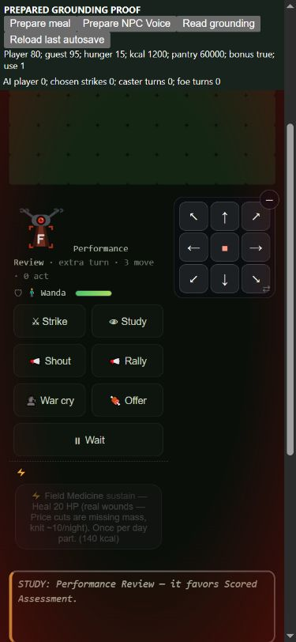

# Personal grounding, paid recovery and Voice settlement

Retain the final repair on `codex/resume-claude`, with feel review requested.
Base: `2223d0ef77888951197fe85aefd96d805e191569`. This is one humanity/cost
unit: five runtime files, one shared-kit test, documentation and evidence.
The original timestamp-reading prototype and diagnostic variants are retained
as unadopted experiments. Regions, policies, observer, contract, food prices,
thresholds and power formulas are unchanged.

## The person owns the cost

Current bearer still uses `scholar.grounding`, preserving legacy saves.
Other people use global `state.groundingByPerson`, default100. Reads do not
create NPC records; explicit zero survives. The global store survives village
replacement. Real succession archives the departing person's value and moves
the successor's value into scholar, deleting its NPC mirror. Integration and
other office history remain inherited. Death no longer hands a successor the
dead bearer's humanity, and succession does not erase a successor's own cost.

NPC Rally Cry now spends the same existing five grounding as a player Voice.
Its existing120kcal-equivalent hunger, once-per-fight limit, action and support
effects are preserved. Charge the actual speaker before commanded actions can
pass the mantle. Player precheck uses the canonical distinct-ally selector;
a self alias cannot consume food or humanity. Voice use/action and daily stamps
are reserved before an effect can save. The final successful combat/daily
action saves its settled costs, effects and gates. Reloading that last autosave
cannot refund/re-arm the paid cast. No manual extra save is needed in the proof.

An NPC tier crossing names the person without charging the player's trust.
This is not complete NPC social or food-conversion parity. Existing player
reactions remain. Tiers75/50/25 and factors1/.9/.75/.6 stay fixed. Only the
existing feasted consumer uses that factor; ordinary topped-up overcharge
remains1.25x. NPCs still lack the corresponding feast-state consumer. A new
blanket damage penalty would invent a different rule and is not introduced.

## Recovery needs an actual human act

The existing documented rates now have two more concrete receipt paths:

- A paid host feast restores3 per distinct living nonreactor diner when at
  least two actually eat together. Absent/dead/uninvited people, failed meals,
  same-day retries and a cold reactor seat receive none. Two human guests
  can share beside a reactor host; one human diner alone cannot. This human
  diner interpretation is a feel-review choice, not the unresolved Garden
  whole-village seven-day deed definition. Pantry allocation is unchanged.
- A finite NPC plant/monster lesson restores2 to its actual teacher. An
  exhausted ask, generic line or place-only promise without knowledge transfer
  receives none. The earned recovery is saved with the spent lesson.
- Table facilitation restores2 and credits teaching only after actual new
  plant knowledge reaches a living present other villager. Already-known,
  self, phantom and away targets cannot farm humanity/facilitation credit.

Kept-favor/grief receipt wiring, daily Voice player support, and full NPC
feast/social effects remain separate work. See TABLE.md's runtime-status note.

## Corrected matched campaign results

64 standard seeds for each of capable/maker/merchant/caregiver,150 days,
Columbus origin, same source-bound policies, shared harness and23-metric
observer/contract. The retained prior final panel is reused as the baseline
only after all207 normalized manifest entries match the frozen2223 source.
Each final arm retains260 jobs:256 observed plus four observer-off controls.
Both arms have stable sources, passing sampled neutrality and zero warnings
or observer/gear errors. The corrected16-seed screen is a subset of its64 arm.
Final64 reused all68 candidate screen jobs rather than rerunning them.

| Measure, counts out of64 unless stated | Capable | Maker | Merchant | Caregiver |
| --- | --- | --- | --- | --- |
| Table wins | 56→57 | 18→18 | 24→24 | 23→23 |
| First bearer survives day60 | 34→34 | 53→53 | 57→57 | 54→54 |
| Bearer deaths, total | 93→93 | 57→57 | 45→45 | 48→46 |
| Community losses | 7→7 | 20→19 | 17→16 | 16→17 |
| Player named-class access | 48→48 | 55→55 | 46→47 | 48→48 |
| Earned tier3+ weapon/armor | 63→63 | 64→64 | 64→64 | 64→64 |
| Tier3+ contest/show weapon/armor | 62→62 | 62→62 | 64→64 | 64→64 |

The existing comparator reports `no_material_signal` in every final cohort.
This is not equivalence or a fairness/fun verdict. All23 metrics, exploratory
paired intervals and coverage are retained in
[grounding-compare64.md](grounding-compare64.md). Merchant sampled low-food
exposure rises.0041→.0048; caregiver low-health exposure.0036→.0040 while
NPC hungry exposure falls.0473→.0470. Preserve those directions beside the
death/community tradeoff; higher wins do not cancel another warning.

41/256 final campaign rows differ and255 final hashes differ. This unit
changes humanity/history/receipts as well as some trajectories; these are not
all metadata-only differences. The sample contains42 player Voice-holder
cases and **zero eligible NPC Voice-holder cases**. Prepared casts prove
the NPC price and save behavior, not natural NPC acquisition or viability.

## Investigating losses and a telemetry confound

The first prototype added `grounding_changed` through a normal timestamp read.
The harness clock increments on every `Date.now` and supplies generated IDs;
adding receipt timestamps can therefore change trajectories. Its16-screen
merchant community warning and64-screen caregiver win warning cannot be
read as clean gameplay effects. Preserve the prototype rather than erasing
that evidence. Its full test suite passed948/948: functional tests alone did
not detect this measurement problem.

The final event reuses the last recorded timestamp (or0 if none), with current
day/part and actual person/before/after/reason. It never reads the clock.
A dedicated runtime assertion enforces that. This does not change the shared
observer/contract or introduce a fabricated current timestamp.

Merchant seed2 demonstrates why both source controls and judgment matter:

| Diagnostic arm | Actual result |
| --- | --- |
| Original baseline | survives150 days |
| Prototype | village dead at calendar day138 |
| Prototype without meal recovery | village dead138 |
| Prototype without mantle transfer | village dead138 |
| Prototype without either | village dead138 |
| Same no-meal/no-mantle arm with clock-neutral receipt | survives150; baseline row and all23 metrics identical |
| Final with clock-neutral receipt | village dead138 |
| Final without meal recovery only | village dead138 |
| Final without mantle transfer only | village dead138 |

The clock-only contrast in the otherwise matched no-meal/no-mantle pair
establishes a confound in that case. It does **not** explain away the final
loss: either recovery/succession change can still lead to this loss in the
named final controls. Baseline mantle day75 preserves81; final has91 before
succession and inherits100. Other downstream interactions remain involved;
do not describe this as a unique isolated damage or food-buff cause.

Caregiver seed9 is another retained real loss: survives150 before, village
lost141 after. Its first mantle is day124,42→42 before versus72→100 after;
the old arm later changes bearer twice more. The final16 community warning
persists as one extra community loss in64, alongside two fewer bearer deaths.
Named merchant2/3 and caregiver9 paired replays reproduce final row, full
state hash, all23 metrics and source digest exactly. Two additional prototype
merchant replays are retained. These are eight named traces, not an all-run
cast census. No lever is adjusted to recover a desired win rate.

Decision: retain person ownership and receipt-backed documented recovery,
keep the small community tradeoff visible for feel/holdout review. Winning
should stay hard. Neither a win decrease nor this small aggregate signal
automatically means a regression or an improvement.

## Runtime and phone proof

`scripts/godpath/test-grounding-person.js`:41/41, one shared-kit harness.
It exercises real casts, actual last-autosave reloads, succession with zero,
history persistence, paid/failed/repeated meals, actual finite plant transfer,
Table teaching/no-op refusal and the unchanged overcharge formula.
Quick176/176; final full948/948. Logs are retained under this prefix.
The frozen prototype fails the final timestamp assertion,40/41, as expected;
its earlier40-assertion proof and green suite are retained separately.
`check-wired table.js` only reports the pre-existing unused tableTheme;
the new helpers have runtime callers.

Final-source browser390×844: authored fixture buttons prepare stores/builds
and expose a read-only receipt. Actual native Host a feast → Light the fire
pays1500, host1000→1750kcal, pantry20000→18500, humanity50/40→53/43.
Reload last autosave retains these values; the native planner refuses a second
feast. The actual48-time-unit ritual also ticks NPC hunger30→33, unlike the
direct hostFeast engine call's30. No feast-buff devotion gate is waived.
Native combat Wait lets the actual NPC Voice cast: player80 stays80,
NPC100→95, hunger10→15, use1, extra turn. Reloading the last autosave retains
all of it; native Study spends the player's action. Screenshots and AX snapshots
are retained. These are prepared access proofs, not natural campaign discovery.



## Reproduce and maintain

```text
node evidence/2026-10-16/grounding-verify.cjs
node evidence/2026-10-16/grounding-verify.cjs --current
node evidence/2026-10-16/grounding-reconstruct.cjs before <fresh-before>
node evidence/2026-10-16/grounding-reconstruct.cjs after <fresh-after>
node evidence/2026-10-16/grounding-probe.cjs <fresh-after> merchant 2 <trace.json.gz>
node evidence/2026-10-16/grounding-server.cjs <fresh-after>
node scripts/godpath/test-grounding-person.js
```

The verifier defaults to frozen evidence; `--current` also verifies current
runtime/test source and executes the41 assertions. Reconstruction needs the
pinned base commit locally, rejects existing destinations, retains its adjacent
tar and checks all207 manifest entries; archives have no own.git. Diagnostic
arms are `prototype`, `no-meal`, `no-mantle`, `no-meal-or-mantle`,
`clock-control`, `clock-no-meal`, `clock-no-mantle`; none is adopted gameplay.
The source bundle includes exact overrides for all arms and the focused test.
Retained jobs:260 baseline +260 final +260 prototype +12 diagnostic =792.
Screens are retained too and verified against their larger panels. The receipt
hashes raw artifacts and reproducibility scripts. Normal quick/full discovers
the focused test automatically. Keep that hook and the timestamp assertion
when changing costs, lesson receipts, saves or succession; update this evidence
and SURVIVAL-LEVERS.md together. No policy, observer or metric tolerance changes
were needed, so the shared Muse tooling branch remains usable as published.
The loopback server opens `/proof` on port8770 with the retained fixture and
the selected root's runtime. Frozen archives omit optional art assets; use
the full checkout for identical art. Fixture preparation is explicitly labelled.
