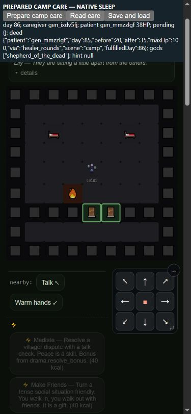

# Shepherd: real care followed by shared survival

2026-10-16. Base `776fac2ee80f53a43c61378ffaa058433a3166dd` on
`codex/resume-claude`. Retain this authored gate for design review
(`[needs-eyes]`); do not tune survival to recover the previous win count.
Six god deeds now replace their proxies; four remain. Garden/reactor human
questions, broad NPC care parity and the larger roadmap remain open.

## Behavior and levers

Another known living person must actually recover from at most25% of their
body's maximum HP to above25%, or be saved from a real fatal fall by allied
Lifeline. Both actual people must then be alive at a later real endDay dawn.
The25% threshold is an Agent-authored data choice in caregiver.god.deed,
not a quotation or new law from Steve. It does not alter healing strength.

Real camp healer rounds are the noncombat route: their existing15HP/day
can cross the critical threshold. The actual player medic or named NPC doctor
owns the receipt. Paid tactical Mending and actual allied Lifeline also count.
Self-care, empty taps, ordinary noncritical healing, a heal that leaves the
patient critical, anonymous helpers and personal death refusal do not count.
No new fee, food-deed waiver, arbitrary repeated-use quota or magic slot.
Class, payoff, four path magic abilities and day80 still govern ascension;
existing active gods need no retroactive rescue.

Pending receipts are separate from completed deeds. Merely changing the day
and querying status cannot settle them. Death before a later dawn invalidates
that candidate; a future real rescue can qualify. After fulfillment, the first
person-owned receipt is immutable, including after later deaths/succession.
The ordinary status check still requires a living prospective god. Pending
and completed records serialize normally. The dawn wrapper settles after the
actual world/night outcomes, runs ordinary ceremonies and saves the result
because core endDay saved before that wrapper. Extra saveSeq and rolling
telemetry differences remain in full hashes; they were not normalized away.

## Validation and native playtest

- Shared-kit original21-check RED:11 passed/10 failed; final32/32 pass.
- Full968/968 and quick196/196; prior caregiver support26/26 remains green.
-111 ontology systems validate, godpath has0 unwired functions; the new
  critical fraction has a finite0<f<1 data contract.
- Both ceremonies, day80, full build/payoff, known-class hint, real critical
  rounds/Mending/Lifeline, own-refusal priority, attribution, death before
  dawn, actual pending/completed save/load, automatic dawn snapshot,
  succession and legacy-active-god preservation are covered.
- An independently reconstructed exact211-entry candidate passes32 checks;
  its capable seed1 standard child equals the entire original child result.
  Two separate observe0 traces match the respective observed raw rows and
  full gameplay hashes. A source-keyed screen resume reuses all68 jobs.

Prepared390×844 phone fixture: Luigi, an authored full Healer kit plus human
Field Medicine, and Lily at20HP in a funded Haven. Native Continue, Wait and
Sleep performed rounds20→35 on day85; both survived to86 and the real
ceremony recognized Shepherd. Explicit save→erase live ledgers→load returned
true and restored the receipt; reload→native Continue retained patient38HP,
the completed85→86 receipt and active Shepherd. The extra3HP came from
ordinary nightly recovery. The4-magic/1-earned-slot kit is prepared, not
natural acquisition. A dawn Sleep initially refused normally; native Wait
advanced128ticks before Sleep. The first diagnostic read lost its temporary
patient variable on reload (displayed undefined); the final fixture derives it
from the persisted receipt, and both raw observations are retained. Existing
optional-data404s appeared in the local server log; boot/save/native flow
worked. No SW/version bump or player deployment.



## Paired campaigns: all23 metrics, no win target

Same four standard policies and150-day horizon.16-seed screen and disjoint
64-seed holdout;656 retained workers =328 new candidate +328 exact baseline
reuse from caregiver-support-after report/jobs. The baseline211-entry source
manifest matches exactly. All raw source/collector bytes, fingerprints,
jobs, observer neutrality checks, warnings and changed-hash indices remain.
Do not pool screen and holdout as one confirmation sample.

| Cohort/policy | Wins | Player deaths | Community losses |
| --- | --- | --- | --- |
| screen capable |12→12|18→18|2→2|
| screen maker |4→4|18→20|4→5|
| screen merchant |4→4|18→18|6→6|
| screen caregiver |9→8|10→10|4→4|
| holdout capable |48→47|88→89|13→14|
| holdout maker |20→21|82→79|21→20|
| holdout merchant |23→22|56→57|28→28|
| holdout caregiver |34→34|45→43|15→15|

Both scorecards say review_required. Screen maker deaths/community and
caregiver invitation/entry are regression_watch; holdout maker player class
access0.8125→0.7813 is regression_watch. Read the complete
[screen](shepherd-deed-screen-score.md) and
[holdout](shepherd-deed-holdout-score.md) for all23 metrics and exploratory
paired intervals. Win movement is descriptive; neither direction establishes
a defect or improvement. Reduced proxy ascension changes later food,
population, build and ending trajectories. No compensating tuning is included.

All64 screen hashes and250 holdout hashes differ. Selection was locked to
every changed raw row/metric, class/god identity, any Shepherd/Lifeline
exposure, and first/last remaining changed hash per policy/cohort (all changed
hashes if at most32).41 pairs/82 replays match whole raw rows, whole balanced
observations, warnings and full gameplay hashes. The other273 changed hashes
remain unclassified. Some selected pairs differ only in receipts, saveSeq,
telemetry and pacing; others diverge materially. Do not generalize the former
to the entire panel. Six holdout hashes remain equal.

## Natural evidence and remaining gaps

The three screen metric-changing cases (capable1, maker3, caregiver3) lose an
old proxy NPC Shepherd. Maker3 changes survived150→community loss143;
caregiver3 changes win119→survived149 without a win. Holdout capable10039
and merchant10037 also lose proxy NPC Shepherds and end in community loss;
maker10053 instead changes community loss132→win145. These are investigation
cases, not justification to make winning easier.

Natural exact replays establish a noncombat care route. In maker10050,
NPC `gen_wezza5v` treats `gen_8bnapea`19→34 on day11, completes at12,
and a stored NPC Shepherd survives in the ending state. Merchant10047's
`gen_z4dwzgm` treats `app_mgpspiqx488`25→40 on95, completes/ascends96;
it survives to the150-day limit instead of the prior community loss125.
Maker10053's final bearer Oliver Moore treats `gen_2hpomcw`12→27 on119,
completes120, ascends141 and wins145. The history includes succession;
do not confuse ever-player god access, stored NPC mirrors and the current
bearer. `shepherd-deed-natural.json.gz` retains actual completion roles.
Earlier player Lifeline opportunities maker10004/caregiver10037 are also
selected; the latter already has a first camp-care receipt18→19, which a
later rescue correctly cannot overwrite.

Most NPC proxy access disappears: screen NPC Shepherd cases3→0, holdout
13→1. Player Shepherd access is screen1→1, holdout8→9. Natural panels do
not establish all-playstyle viability, opportunity denominators, healer
availability, every care skill or field/army parity. Battlefield Grace NPC
payoff attribution and the formal NPC30HP/gear model remain separate work.
No new care policy, kit ordering, regional/nomad code, enemy, reward or price
change is bundled. Broader noncombat gear/contest/TV audits remain roadmap
work; this gate alone does not resolve them.

## Repeat and keep current

Use `node scripts/check.js --quick` after edits and full checks before push.
The32-check test is automatically discovered. For future experiments, freeze
both roots before running policies; retain the same raw seven-file observer
overlay,211-entry manifest, distinct cohorts and complete23-metric scorecards.

Rebuild historical evidence with:

```text
node evidence/2026-10-16/shepherd-deed-reconstruct.cjs before <fresh-root>
node evidence/2026-10-16/shepherd-deed-reconstruct.cjs after <fresh-root>
node evidence/2026-10-16/shepherd-deed-verify.cjs --collector-root <rebuilt-root>
```

The receipt seals121 proof/tool artifacts; this narrative audit and the final
verification output are outside that seal. Never overwrite the sealed source
bundle, jobs, traces or receipt. Use a new prefix for the next lever. Update
ROADMAP, PLAN, SPINE, SCALE-AUDIT, SIMULATING, lane ownership and
SURVIVAL-LEVERS with code changes. Preserve named unknowns and both adverse
and favorable cases. Muse can consume the branch and these common workflows;
publication here does not merge or deploy a player build.
